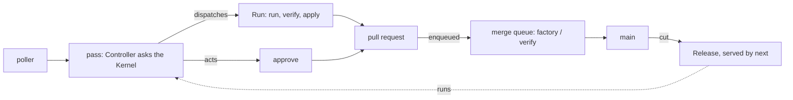

# software-factory

The Factory is a set of agent Roles that turn an issue into a reviewed, merged change, and a small
core that decides what each Role may do next. This repo is that core, the parts that run it on
GitHub, and the context its authors work from. The Factory already reviews and approves the pull
requests in this repo, and runs from its own Releases.

If you are about to change something, read `AGENTS.md` first. It is one page. Capitalised words
such as Role, Run, Lens and Release have one meaning each: see `docs/glossary.md` and the
glossary it points to.

## The idea

- **No stored state.** The Factory reads the open Work items from GitHub, and the records of its
  own past Runs, and works out from those alone where each item stands. If a
  pass is lost, the next one works it all out again from what it reads.
- **One pure function decides.** The Kernel (`kernel/`) does no I/O and reads no clock. Every reason
  it gives is a code, never a sentence, and no text from outside reaches a decision.
- **The model never holds a credential that can write.** A Run's `run` job gives a model a Task and
  gets back a Result that only asks for changes. A separate `verify` job, holding no secret, checks
  the Result by its digest, and a separate `apply` job reads the item again before it writes anything.
- **People act in GitHub.** A person's hold label stops an item, and a person's request for changes
  blocks it.
- **Every rule names the check that holds it.** A rule no check holds is not a rule here.

The whole design, on one page, is section 0 of `docs/architecture/software-factory-design.md`.

## What runs today

- The **poller** (`.github/workflows/poller.yml`) runs three times an hour, and whenever a run of
  the `factory` or `ci` workflows ends. Each time it calls one **pass** of the Controller.
- The **pass** reads every open pull request through the ports in `adapters/`, asks the Kernel
  about each one, records what it decided, and then dispatches Runs and acts. The poller, the Run
  and the acts run the code of the Release that the `next` Channel points to, not whatever is on
  `main`. Issues are read only once `issues.served_from` is set in `config/defaults.json`, and it is
  not set yet.
- One Role is built: **`pr-review`**, the review Role, whose one Intent is `review-change`. It
  reviews pull requests in this repo and writes through its own GitHub App.
- When the Kernel finds a change ready, the **approve** act approves it with the machine user's
  token (decision 0055). The **queue** act, which would put it in GitHub's merge queue, is built
  but not switched on: `config/controller.json` names no queue App, so the Maintainer's account
  enqueues it (decision 0198).
- A change to a model Lens's own inputs (for the review Role: its prompt, its rubric, the Harness
  and the other `pr-review` entries under `lens_inputs` in `config/hooks.json`) waits for the
  approval of a different person with write access (decision 0052).
- **Releases** are tags `factory/vX.Y.Z` on `main`, cut through `.github/workflows/release.yml`.
  The `next` Channel serves this repo (`release/rings.json`). The skill
  `.claude/skills/cut-a-release/SKILL.md` says how to cut one.
- Built ahead of the Roles that will use them: a Run's hand-over of code as a patch, by its digest
  (decision 0219), and the first guard, `guards/patch.py`. The push itself (`harness/push.py`) is
  not built, and no guard is called yet.
- Not built yet: every Role but `pr-review`, and a page that shows the Controller's view to people.
  Each directory's `AGENTS.md` names its parts still to come.

## How a change moves



A Run is one workflow run of one Intent by one Role on one Work item (`.github/workflows/run.yml`
calls `.github/workflows/run-jobs.yml`). The poller, the Run and each act start from a small
frozen shim that does no more than call its jobs at the Channel.

## The repository

| Directory | What it holds |
|---|---|
| `kernel/` | Every decision, as pure functions: the State of a pull request or an issue, what happens next, the brakes, the gate and a review's coverage |
| `lifecycle/` | The States of each type of Work item and the moves between them, as data, checked to terminate |
| `schemas/` | One JSON Schema for each message that crosses a boundary and each data file |
| `examples/` | An example of each message, and counter-examples that must be refused |
| `config/` | The settings, as data: the Kernel's limits, who owns each kind of Finding, the review rubric, the Apps, and what the session hooks protect |
| `controller/` | The Controller: one pass as a function of what it read, which reads no clock and writes nothing itself, and the entry the pass job runs |
| `adapters/` | The ports: all of the Factory's I/O. Only `adapters/github.py` and `adapters/azure.py` reach the network |
| `harness/` | A Run's jobs (building the Task, running the model, applying the Result), the jobs of the approve and queue acts, and `harness/eval/`, the eval job |
| `guards/` | Pure functions that bound what a Role's own push may land |
| `roles/` | The Role manifests and the review Role's prompt |
| `release/` | How the Factory ships itself: the Channels and the rules that cut a Release and move or roll back a Channel |
| `evals/` | One manifest for each held-out eval set, whose cases live in a private repo, never here; and the context's own test, `evals/context/task.json` |
| `sim/` | A fake GitHub that drives the real Kernel, injects faults, and checks the invariants after every step |
| `trials/` | What the real GitHub was seen to do, one redacted fixture for each platform trial; the fake GitHub is held to these |
| `tools/` | The checks, the mutation check, the session hooks (`tools/hooks/`) and the scripts the Maintainer runs by hand |
| `tests/` | The tests: a boundary case for each Kernel rule, the simulations, and a failing case for each check |
| `docs/` | The standards, the decision records, the lessons, the glossary, and the design as it was written |
| `.github/` | The workflows, the code owners and the pull request template |
| `.claude/` | The session hooks' settings and the skills a task loads |

Every top-level directory but `.github/` and `.claude/` has its own `AGENTS.md`, with the rules of
that place. At the top level,
`Makefile` runs the checks, and `sonar-project.properties`, `.coderabbit.yaml` and the
`.gitleaks` files configure outside reviewers and the secret scan.

## Working on it

Python 3.9 or later, with the standard library alone: there is nothing to install. There is no
type checker, since one would be an install (`docs/decisions/0014-where-this-repo-departs-from-the-orgs-standards.md`).

```
make checks                      # every check, about half a minute
python3 -m tools.mutants PATH... # the mutants of the files a change touches
```

Run those two before a change is finished, as the Verify block of `AGENTS.md` says, which also says
when to run every mutant of a file. The tests themselves run in CI: the required check,
`factory / verify` (`.github/workflows/verify.yml`), runs `make checks` then `make tests` in three legs on every pull
request and merge group, and the mutation check in shards on the merge group alone. Its verdict
job and its `commits` job run the base's tools, never the head's, so a change cannot write its own
verdict (decision 0023). The checks and tests themselves run from the head, which is why a change to
them is a Lens input in `config/hooks.json`.

The session hooks in `.claude/settings.json` run the checks after an edit and before a stop, refuse a
commit that does not name the Maintainer, and, outside bypass mode, ask before a protected edit or a
merge. They catch mistakes at the desk; CI's `commits` job is what holds every commit to the
Maintainer's name.

To change the Kernel, follow the five steps in `AGENTS.md`: a boundary test first, then the code,
then a mutant that the test kills.

No environment variable is needed. `SIM_SEEDS` sets how many seeds both simulators run, 300 if
unset, which is what CI runs.

## Where to read next

| To learn | Read |
|---|---|
| The rules and the commands | `AGENTS.md`, then the `AGENTS.md` of the directory you are in |
| The design | `docs/architecture/software-factory-design.md`, section 0 |
| Why something is built as it is | `docs/decisions/`, one decision to a file |
| What went wrong before, and the check that now stops it | `docs/lessons.md` |
| How code, tests and workflows are written here | `docs/standards/` |
| Why the context files are shaped as they are | `docs/context-engineering.md` |

## License

MIT, in `LICENSE`.
