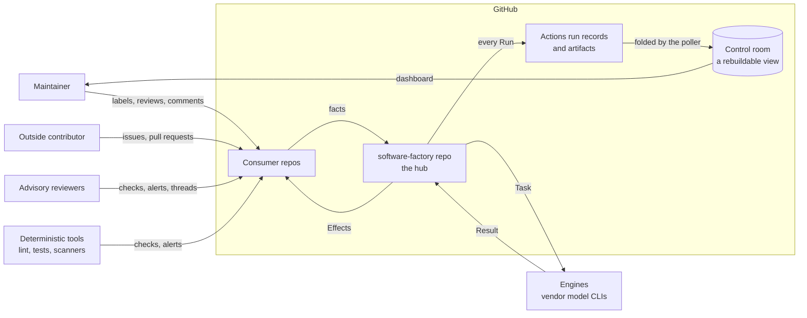
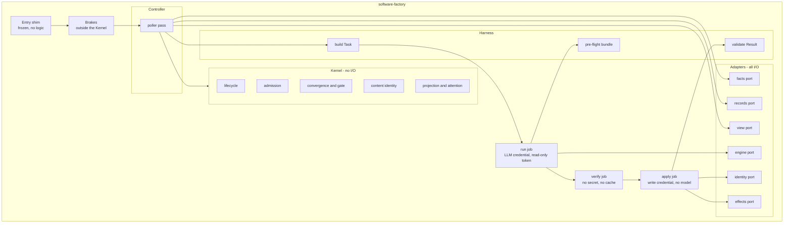
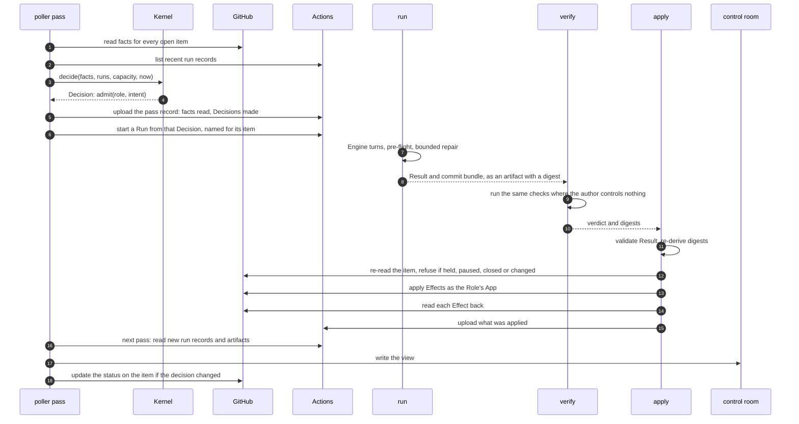
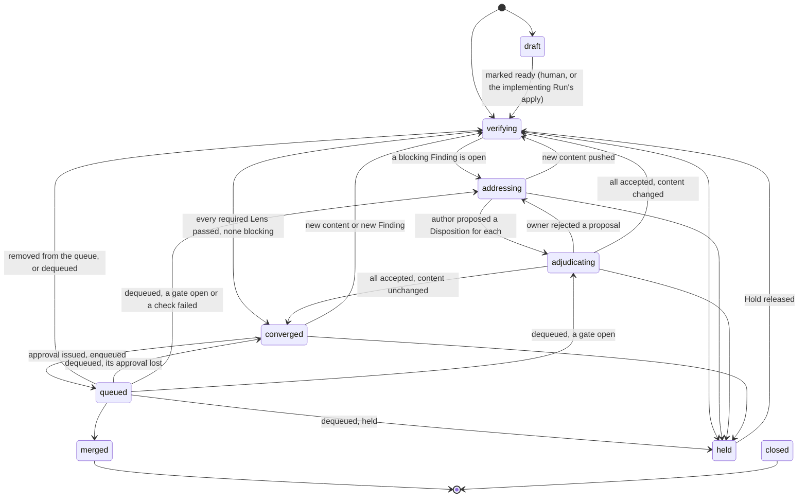
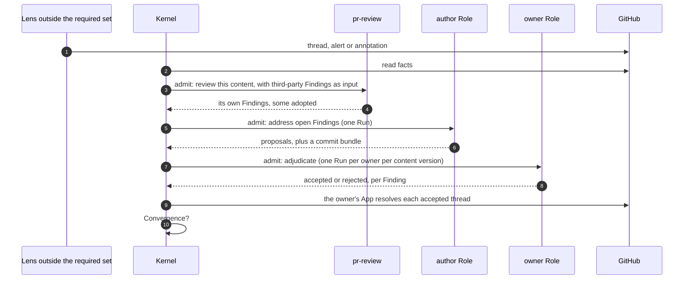

> First written in `combsmith/.github-private`, on the draft pull request "docs: factory MVP — PRD, architecture review, market research and ADR-0013 (proposed)" (number 2225, commit `7d7d04f`). It now lives in this repo. Citations of files and lines in `.github-private` are evidence about the current system and are left as written.

# Software Factory: interaction and contract design

**Status:** Draft for maintainer review
**Date:** 2026-10-10
**Builds on:** [ADR-0013](adr/0013-factory-mvp-reference-architecture.md), the [PRD](../prd/agentic-software-factory.md) and the [architecture review](factory-mvp-architecture-review.md)

## 0. The design on one page

The Factory is a set of agent Roles that turn an issue into a reviewed, merged change across the
org's repos, and a small core that decides what each Role may do next.

**It keeps no state of its own.** Every few minutes one job, the poller, reads every open work item
from GitHub, and reads the list of the Factory's own past Runs from GitHub Actions. From those two
things alone one pure function, the Kernel, works out where each item stands and what should happen
next. If a tick is lost, the next one reaches the same answer.

**A Run is one workflow run with up to three jobs.** `run` gives a model a Task and gets back a
Result that only requests changes. `verify` runs the checks where the author controls nothing.
`apply` reads the item again, and only then makes the changes, through the Role's own GitHub App.
The model never holds a credential that can write.

**A change converges when** every required check has passed, no required reviewer and no person
with write access has an open objection, and, once acceptance contracts are in force, every
criterion written before the work has passing evidence. Third-party reviewers inform the in-house
reviewer, and gate only through it.

**People act in GitHub.** A label holds, releases or admits. A review blocks. A comment steers. The
Factory reaches the Maintainer by assigning the item to them.

**The control room** is a public page built from the Runs' own records. The Factory writes it and
never reads it, so it can be wrong without anything going wrong.

**It is built review-first,** in a repo of its own, served by its own newest Release. The first
milestone is the Factory approving one of its own pull requests.

**Not yet designed** (§9.9): how a Release is cut; what the Factory does as capacity runs short;
how an interrupted Run resumes; the scorecard's sums.

## 1. Purpose

ADR-0013 says what shape the Factory has and why. This document says how its parts talk to each
other, precisely enough to be checked before any of it is built. It is written to be argued with:
every contract has an example, every behaviour has an invariant, and every invariant has a named
way to test it.

It has five layers. Each is an artifact that a check can read.

| Layer | Question it answers | Artifact | Checked by |
|---|---|---|---|
| 1. Structure (§2) | What are the parts and who calls whom? | Diagrams in this document | Review |
| 2. Contracts (§3) | What exactly crosses each boundary? | One schema and golden examples per message | Schema validation of every example |
| 3. Behaviour (§4) | What may happen, in what order, and what must never happen? | The Lifecycle as data, a list of invariants, a simulator | Exhaustive checks on the Lifecycle; seeded simulation with injected faults |
| 4. Team interactions (§5) | Which Role sees what, raises what and decides what? | Role manifests and an authority table | Mechanical checks on the data |
| 5. Platform facts (§6) | What does GitHub actually do? | A list of spikes with pass criteria | One trial each on a canary repo |

Terms are those of the PRD glossary and are used exactly.

### 1.1 Decisions this design takes as given

Made by the Maintainer on 2026-10-10, in addition to ADR-0013's twelve decisions.

| Decision | Effect on this design |
|---|---|
| The repo is `combsmith/software-factory` | Named throughout |
| A Finding is decided by the Role that owns its domain | The authority table (§5.2) and the Finding lifecycle (§4.3) |
| One GitHub App per Role | Each Role's permissions are a ceiling GitHub enforces (§5.1) |
| The LLM credential is a subscription of the Factory's own, stored as an environment secret in the Factory repo | The engine port (§2.2); the capacity signal is observed, not read (§3.10) |
| The review Intent is built first and reviews everything after it | The build order (§9) |
| The comparison with the POC is a measure, not a gate | The comparator is a later, non-gating component |
| Stopping is the Maintainer's decision, on adoption and use | §9.2 |
| The Factory's Apps share the prefix `combsmith-sf-` | §5.1 |
| Every panel of the control room is public | §8.6 |
| Code owners follow the org's standard: the team org-leads owns every path (2026-10-14) | §5.1 |
| A Finding that does not gate is an annotation on its Lens's check run and has no Disposition; a `security` Finding gates at any severity (2026-10-14) | §3.7, §4.2, §4.3 |
| Only required Lenses gate, and domain owners start in shadow (from the pre-mortem, §9.3) | §4.2, §5.2 |
| The Maintainer records continue or stop at two decision points | §9.2 |
| Decisions read GitHub only; the control room is written and never read back (from the simplification pass, §9.4) | §3.9 |
| Every `run` job reads through one shared reader App; a Role gets its own App when it first writes | §5.1 |
| A hosted relay turns webhooks and a timer into nudges; no Consumer repo carries a Factory file | §7.3 |
| Each reviewing Intent declares a rubric, which is a floor and grows from what it missed | §3.14 |
| The Kernel is written in Python, with the standard library only at run time | §7.5 |
| The Factory's own author Role comes before the control room and the shadow Roles | §9.1 |
| Each Lens has a declared scope of paths | Role manifests (§5.3) |
| A Consumer repo's setup and test commands are part of its onboarding contract | The Consumer entry (§3.12) |
| Design by simulation first, with a formal model held in reserve | §4.5 |
| State is derived from GitHub at every evaluation and never stored | §3.9, §7 |
| The record of a Run is its Actions run record and its artifact | §3.10 |
| Work is noticed by a poller; an event may only ask for a pass | §7.3 |
| The control room is a public, rebuildable view with a dashboard, holding 90 days | §8 |

ADR-0000 to ADR-0012 describe the POC and are not constraints here. Four mechanisms that ADR-0013
takes from them are restated in §2.4 as this design's own rules.

### 1.2 How to read this document

Some of it is rule and some of it is record. An implementer builds from the rules.

| Rules | Record of how the rules were reached |
|---|---|
| §2.4, the four rules; §3, the contracts; §4, behaviour and invariants; §5, Roles and authority; §8.4, the feed; §9.1, the build order; §9.6, the serving channel and cutover | §7, options weighed and the build-or-adopt research; §8.3, what came from another analysis; §9.3 to §9.5 and §9.7 to §9.11, the review passes; §9.12 to §9.14, how it is built; §10, edits made to other documents |

The architecture review in `factory-mvp-architecture-review.md` is history. It records
recommendations that were later replaced, and nothing should be built from it.

### 1.3 Still open

- Whether the POC's agents are capped while the Factory is built. They draw on the same model
  window as the Factory. Uncapped for now, with the budget gauge watched.

## 2. Structure

### 2.1 Context



Everything the Factory knows about a Work item it reads from GitHub: the item itself, and the
Factory's own run records. Nothing authoritative lives anywhere else. The control room is a view of
those for people. The Factory writes it and never reads it, so it can be wrong, missing or rebuilt
without changing a decision. Everything the Factory does to a Work item is an Effect
applied by one job.

### 2.2 Components



| Component | Responsibility | May not |
|---|---|---|
| Entry shim | Run from the default branch and call the pinned Release | Contain a step or a `run:` block |
| Brakes | Human Pause, Run ceiling, loop count, and on a metered credential a monthly cap read from the provider | Import from `kernel/` or read the control room |
| Controller | One pass: read facts and run records; call the Kernel; start Runs; write the view | Decide anything itself, or read the view |
| Kernel | Every decision: Lifecycle, Admission, Convergence, the gate, content identity, what the item shows and how urgently it needs a person | Open a file, a socket, a process or the environment; read the clock except as an argument; take a comment body |
| Facts port | One snapshot of a Work item from GitHub | Return text to the Kernel |
| Records port | List the Factory's own run records and read their artifacts | Write anything |
| View port | Write the control room's files | Be read by anything that decides |
| Effects port | Apply one Effect and read it back | Run in a job that holds an LLM credential |
| Engine port | Run one vendor CLI on one Task and return its output | Hold a GitHub write credential |
| Identity port | Mint a token for the Role's App, narrowed to the Effects requested | Mint for a Role other than the one in the Result |
| Harness | Build the Task, run the pre-flight bundle, validate the Result | Interpret prose |

Two ports isolate choices that may change: the engine port (the subscription CLI today, a metered
API later under FR-73) and the identity port (one App per Role, with the mint rule in one place).

### 2.3 One Run, end to end



`verify` is a filter, not the verdict. It saves a push by catching failures first, but the code
under test runs inside it and could forge a pass, and the hub's environment is not the Consumer's.
The Consumer repo's own required checks, run on what was pushed, remain the verdict. How often the
two disagree is measured per Consumer, and `verify` is dropped where it is often.

The `verify` steps are skipped for an Intent that changes no code. The Result artifact exists
before `apply` starts, so it is the record of what was intended (§3.6).

### 2.4 Four rules restated

These came from the POC's decision log. They are restated here so that this design does not depend
on that log surviving.

1. **Thin caller.** A workflow that runs from a default branch has jobs that each `uses:` a pinned
   reusable workflow and nothing else. Its only logic is a job-level `if:`.
2. **Immutable tag, moving channel.** A Release is an immutable tag. A channel is a moving tag that
   points at one, moved through one path by one identity under a ruleset. Moving it back is the
   rollback.
3. **No Factory file in a Consumer repo.** The poller reads every repo, and the relay of §7.3 hears
   their events. Adopting the Factory changes nothing in the repo's workflows.
4. **A concurrency key per Work item, declared at job level.** One running and one pending entry
   per item is the coalescing the design wants, not a defect to work around.

## 3. Contracts

### 3.1 The catalogue

The envelope is carried by what crosses a boundary whole, once, and everything inside it is
versioned by it (decision 0039). Each schema is in one of four classes. A **document** crosses a
boundary whole, written by a Release at run time, and carries `schema` (name and major version),
its identity and the `release` that produced it: a Task, a Result, `applied.json` and
`outcome.json` (identity `run`), the pass record and the feed's two files (identity `pass`). A
**record** travels inside a document and is also given alone to a reader, the Kernel, a replay or a
join, and carries `schema` alone: its identity and Release are its document's (the facts, a
Decision, a Finding). A **part** is only ever inside another, by reference, and carries nothing (an
Effect, a Disposition, coverage, the run-name, a run record, a feed item). A **data** file a person
edits carries `schema`; its identity is its path and its Release the commit (the configuration,
the hooks' data, the Lifecycles, the authority table, the Apps, the feed's table, a Role manifest,
a rubric, an acceptance contract, a fixture). A reader rejects a major version it does not know. Messages are JSON. Files a person edits are shown
here as YAML because it reads more easily; in the repo they are JSON, since the standard library
has no YAML parser and nothing third-party runs in the Factory.

| Contract | From | To | Carries |
|---|---|---|---|
| Facts | Facts port | Kernel | What GitHub holds about one Work item, as data |
| Decision | Kernel | Controller | Nothing, defer, hold, transition or admit, with a reason |
| Pass record | Controller | Runs, replay | The facts one pass read and the Decisions it made |
| Task | Harness | Engine | Everything one Run needs |
| Result | Engine | Harness | Status, requested Effects, Findings, Dispositions, usage |
| Effect | Result | `apply` | One requested change to the outside world |
| Finding | Any Lens | Kernel | One observation, with a non-text identity |
| Disposition | Author and owner Roles, inside a Result | `apply` | A proposal or a decision on one Finding |
| Run record | Actions, and the Run's own artifacts | Controller | That a Run happened, how it ended and what it produced |
| Control-room view | Controller | People, through dashboards | Every item's computed State, and what only the Factory knows, folded from run records |
| Role manifest | Factory developer | Kernel, Harness | What a Role sees, raises, owns and may do |
| Authority table | Maintainer | Kernel | Who decides each category of Finding |
| Consumer entry | Repo owner | Kernel, `verify` | How one Consumer repo is served |
| Acceptance contract | `qa-lead`, approved by the Maintainer | Kernel, `verify`, the author Role | What a change must show to be correct |
| Rubric | Factory developer, approved by the Maintainer | A reviewing Role, its evals | The least a Role must check, and how it grades what it finds |
| Lifecycle | Factory developer | Kernel | States, Transitions, Gates and actors |

### 3.2 Nudge

A nudge is a request for a pass now. It carries nothing. Every pass evaluates every open item, so
there is nothing for it to say, and "no event carries work" holds because there is no payload to
carry it in.

### 3.3 Facts

One snapshot, read in one query, of what GitHub holds. It is also the fixture format for replay and
for contract tests, so one schema has three uses.

| Field | Content |
|---|---|
| `item`, `state`, `is_draft`, `author` | Identity, open/closed/merged, draft flag, authoring actor |
| `class` | `agent`, `maintainer`, `dependency` or `outside`, worked out by the port from the author and from whether the head is in another repo |
| `last_pusher` | The actor who pushed the head commit, as GitHub records the push: read from the head branch's activity, the newest entry's actor when its `after` is the head commit, a person's push and an App's alike (P-28); null, which is unreadable, `last_pusher_unreadable` for the Maintainer, when the newest entry is not the head commit or there is none. Never the commit's author or committer, which whoever makes the commit writes |
| `targets_protected` | Whether the base branch is a protected one |
| `mergeable` | Whether the head merges cleanly into the base: true, false, or null while GitHub has not worked it out. As GitHub last worked it out: a move of the base alone does not make GitHub work it out again (P-29) |
| `diff_size` | Files and lines changed |
| `head`, `base`, `merge_base` | Commit hashes: the head commit; the base branch's head, read at the pass, never the pull request's `base.sha`, which moves only when the head is pushed (P-29); and the merge base GitHub gives for the head against that branch, `compare`'s `merge_base_commit`. None is in `schemas/facts.schema.json` until something reads it |
| `content_id` | Hash of the pull request's own diff against its merge base, computed by the port |
| `changed_paths` | One record for each file in that diff, as many as `diff_size` counts files, each by its own path once, from the top of the repo, with `previous`, the path a renamed or copied file had before, null for any other change. A list of another length, a record not in that shape, or a path with an empty, `.` or `..` name, is unreadable, `paths_unreadable`, for the Maintainer. The Kernel matches each against the protected paths and the Lenses' inputs, and never shows one (§4.2, decision 0020) |
| `label_events` | Every `labeled` and `unlabeled` event on the timeline: the label, who added or removed it (kind, name and write access), and when |
| `reviews` | Who submitted it (`by`: kind, name and whether that actor has write access, as a thread's opening actor), state (`approved`, `changes_requested`, `commented` or `dismissed`, as GitHub holds it now), commit, `content_id`, `submitted_at`; and, from the timeline, `dismissed_by`: who dismissed it, of what kind and with what access, and `dismissed_from`: what it was before (`approved`, `changes_requested` or `commented`). Both are null unless it was dismissed |
| `threads` | Thread id, path, line, when it was opened, resolved, outdated, opening actor and resolving actor, each with its kind and whether it has write access (the resolving actor null unless resolved); and the Finding's `category` and `severity`. For a required Lens's thread both come from that Lens's own Finding record, in its Run's `applied.json` (§3.7, §3.10), joined by `surface.key`, never from the comment text, which anyone with write access can edit. A person's thread is `human`, with no severity; an Advisory reviewer's, which no Finding record names, has neither |
| `checks` | Name exactly as GitHub gives it, the id of the App that reported it (`app_id`, the check run's `app.id`), the workflow file that ran it (`workflow`, the `path` of its check suite's workflow run, such as `.github/workflows/verify.yml`; null for a check no workflow ran), conclusion as GitHub gives it (or the check's status while it has not concluded), completion time, annotation count |
| `alerts` | Tool, rule, alert number, state, severity, path |
| `queue` | Merge-queue membership |
| `acts_since_writer` | Count of acts that landed since the last action by a person with write access, from GitHub's timeline: each approval, enqueue, dequeue and label a Factory identity made with no model Run |
| `acceptance` | The acceptance contract of §3.13, or null where the issue the pull request closes asks for none, read from that issue and never from the head. `approved`: the contract a person approved, read at the commit of the newest approving review by a person, with its digest, that commit, which a review in `reviews` by that person must hold, who approved it, and each criterion by id and kind, never its statement; null where no person has. `head`: the contract's digest at the head, null where it carries none. A digest covers the contract and every path it protects. `results`: each result read for a criterion, `passing` or `failing`, with the `content_id` of the content its check ran on and that check's name, App and workflow file, the latest per criterion per check suite (§4.8). A contract no person approved, or one whose head differs from it, is a Hold read before anything admits a Run (I-29). Convergence's fourth condition is read from it (§4.2): only this content's results are judged, each only from the Lens the configuration's `acceptance_reporters` names for its criterion's kind, and a `human` criterion only from a person's approval of this content (decision 0025). A contract, or a result on this content, that cannot be read admits and converges nothing. `complete.acceptance` says whether all four were read in full |
| `read_at`, `quota_remaining` | When it was read, and what the installation has left |
| `complete` | For each list above, whether every page was read; whether the diff behind `content_id` was whole; `changed_paths`, whether every path it changes was read; `runs`, whether the list of run records the pass read was whole; and `timeline`, whether the timeline behind `acts_since_writer` and `label_events` was read in full |

An incomplete read is an unreadable one. A list cut off at a page limit must never be taken to mean
"nothing more": the Kernel defers on any fact marked incomplete, and a truncated diff means a
review, never "unchanged". A flag is whole only if it is exactly true; one that is missing or
malformed is incomplete. The list of Runs is read once a pass, and the port sets `runs` on each
item from that one read. Read short, it can hide a Run in progress or one that counts toward a
ceiling, so the item defers (I-13, I-20). A merged or closed item is read from no list, and keeps
its State whatever the flags say.

`acts_since_writer` bounds the acts as the run records bound the Runs (I-8, FR-17). An act that
moves work on, an approval or an enqueue, is made only while the count is below
`max_acts_per_item`; at the ceiling the item is held, reason `act_ceiling`, for the Maintainer to
see. An act that stops work, a Hold label or a dequeue, is counted and never refused. A count that
is missing, negative or not a whole number is unreadable: the Kernel defers and makes no act
(I-13). The count comes from the timeline, which is paged like any list, and `complete.timeline`
says whether it was read in full: a timeline read short undercounts, and the item defers (I-20).
The count bounds acts only; a Run is bounded by the Run ceiling.

A check's `conclusion` is GitHub's own word, or the check's status while it has not concluded.
GitHub's GraphQL gives it in capitals (`SUCCESS`, `IN_PROGRESS`); the port lowercases it and does
nothing else. The configuration's `check_conclusions` says what each word means for a required
check. `success` alone is passing. `failure` and `timed_out` are failing: the content goes back to
the author, because a hung test usually belongs to the content and attempts bound the fixes (L-39).
`queued`, `in_progress`, `pending`, `waiting`, `requested` and `expected`, and a required check that
has not reported at all, are pending: a normal wait that ends on its own, so the item waits in
`verifying`. `neutral`, `skipped`, `cancelled`, `stale`, `action_required`, `startup_failure` and
`error` are unreadable, and so is any word the map does not name, such as one GitHub adds later: a
Lens that gave no verdict has neither passed the content nor found anything to fix. A failed check
is read first. It is readable and decisive: whatever a check with no verdict would have said, the
content goes back to the author, so no decision rests on the unreadable one. Read the other way, an
ordinary failure would wait for a person, because GitHub's `fail-fast` reports one failure beside
`cancelled` siblings, and a job that `needs:` the failed one is `skipped`. With no failure, an
unreadable check is read before a waiting one: the Kernel defers, reason `check_unreadable`, admits
no Run and makes no act (I-13, I-27). The item stays in `verifying` and is the Maintainer's to see,
because almost every such check needs a person: an approval, a change to the required set, or a
re-run. GitHub treats a skipped required check as passing; the Kernel is stricter on purpose, and
L-36 bans the path filters that cause skips. The configuration's schema refuses a map that reads
anything but `success` as passing, or a word as anything but the four readings, so data cannot make
`neutral` pass (`examples/invalid/config.a-neutral-check-passes.json`,
`examples/invalid/config.conclusion-mapped-to-nothing.json`). A required Lens that is `neutral` by
design leaves the required set for that class or scope (§5.3); the map is not bent for it.

A required Lens is read only from the App that reports it. GitHub lets any App with `checks: write`
post a check run under any name, the Controller's among them; the ruleset pins `verify` to its App,
and the Kernel pins every required Lens to its own. The configuration names each deterministic Lens
(`config/defaults.json`, `required_lenses.deterministic`) with `check`, the exact name of the check
run GitHub reports for it, and `app_id`, the id of its App: `verify` is the check `verify` and
`secret-scan` the check `Secret scan (gitleaks)`, both from GitHub Actions, 15368, the integration id
the `main` ruleset pins for `verify`; `code-scanning` is the check `CodeQL`, from GitHub Advanced
Security, 57789, as the check runs of a merged pull request's head showed on 2026-10-15. The
schema refuses a Lens with no check or no App (`examples/invalid/config.a-required-lens-with-no-check.json`,
`examples/invalid/config.a-required-lens-with-no-app.json`), and `tools/check_authority.py` a Lens
or a check named twice, a model Lens among them. The port's contract: it gives every check run on
the head in the facts with its exact name as `name` and its real `app.id` as `app_id`, from every
App, and never drops, merges or renames one. The Kernel matches a check to a required
deterministic Lens by that Lens's `check`, exactly, never by the Lens's own name: a job named
`secret-scan` is not the check `Secret scan (gitleaks)`, and passes nothing. Only a re-run of the same job in the same
check suite replaces an earlier run: GitHub's `filter=latest` is per check suite, so two workflow
runs on one commit both stay, and the Kernel reads both, which fails closed. Both rules wait on
`adapters/`.

GitHub Actions is one App, 15368, for every job in the repo, one a pull request adds in a workflow
file of its own under a required Lens's check name among them. So a Lens that Actions runs is also
pinned to its workflow file: the configuration's `workflow` names it, `.github/workflows/verify.yml`
for `verify` and `.github/workflows/ci.yml` for `secret-scan`, the files whose jobs carry those
names, and null for `code-scanning`, which no workflow runs. The port gives each check run the `path`
of its check suite's workflow run as `workflow`, and null for a check no workflow ran (trial P-35).
The Kernel matches the path exactly. A check under a Lens's check name from its own App and another
path, or with no path read where the Lens names one, is read as one from another App is, with the
evidence `<lens>:from_workflow:<path>`; and a check that names a path, where the Lens names none, is
not that Lens's either. The evidence shows the path only in the form a Lens's workflow takes in the
configuration, `.github/workflows/` and a name of ASCII letters, digits, `.`, `_` and `-` ending
`.yml` or `.yaml`, no longer than `max_path_length`; any other, a `dynamic/` path, a look-alike or a
control character among them, is shown `unreadable`, so text from outside never reaches a Decision.
`tools/check_workflows.py` holds the configuration to the files: a Lens whose App is GitHub Actions
names a file, no other Lens names one, and the file exists, runs on both `pull_request` and
`merge_group`, and has a job whose own `name:`, or whose id where it has none, is the Lens's check,
with no `strategy.matrix` or `uses:`, either of which would leave the Lens waiting. Its one job-level
`if:` is exactly `always()`, and only beside a `needs:` that names every other job in its file: any
other `if:` can skip the job, and GitHub passes a required check that is skipped. So `verify` needs
`checks`, which runs `make verify`, and `mutants`, the shards of the mutation check, and runs
`tools/needs_passed.py` on `${{ toJSON(needs) }}`, which fails it unless each ended `success`
(decision 0026).

The pin is to the path, not to what the file says, nor to what it runs. A pull request from a
branch of this repo can change the file at that path in place, and its check still reports from
it; so can a dependency bot's security update, which edits the pins in workflow files. `verify`
runs the pull request's own Makefile, tools and tests, and the secret scan reads its own
`.gitleaks.toml`. A change to such a file, or to any of the Factory's own rules, converges only
once every model Lens has reviewed its head, a dependency update's too, and the machine user then
approves it (§4.2, I-45, decision 0020). What holds `.github/` today is GitHub
refusing an App's push there without the `workflows` permission, which no Factory App holds
(`config/apps.json`, held by `tools/check_apps.py`); a person's admission of a fork's pull request
after its last push (I-36); a Role's `apply`, which waits on `harness/`; and the session hooks,
locally. The `main` ruleset requires no review and pins only `verify` to its App; pinning each
required check is the Maintainer's, in the repo's settings, with
"The Factory repo's rulesets hold the Release tags and each required check's App" (issue 62), and
the Kernel's pin does not wait on it. A Lens
no workflow runs has a gap of its own: whether an upload to code scanning under CodeQL's tool and
category, by an identity holding `security_events: write`, can replace the CodeQL verdict is
unverified (trial P-36). Such an upload would be reported by the Lens's own App under its own
check, so the Kernel could not tell it from the Lens.

A check under a required Lens's check name from any other App, or with an App id that is not a whole
number, makes that Lens unreadable whatever it concludes, and whatever the Lens's own App says
beside it. It is read before the failure of any Lens and before a conflict, as `review_unreadable`
is, because a fix Run is an action: reason `check_unreadable`, for the Maintainer to see, since an
App posting under a Lens's name is a person's to look into (I-13). Its evidence is
`<lens>:from_app:<id>`, or `<lens>:from_workflow:<path>` for another workflow file of the Lens's own
App, so it is not taken for a check that was cancelled. A check run cannot be
deleted, so it stays on that head, and only a push clears it. Every check from the Lens's own App is
read, never the last alone: any that fails fails the Lens; failing none, any that gave no verdict
leaves it unreadable; then any still running is a wait. The Lens passes only when every one passes.
The status on the item, the Controller's own check run, has one fixed name, `status_on_item` in the
configuration, and `tools/check_authority.py` refuses it if it is a required Lens's name or its
check's, deterministic or model, ignoring case and the space around it: it would speak for that Lens.

A request for changes from a person with write access is a `human` Finding (§4.2 item 3), and gates
as that person's thread does: the author's Run answers it, and then it waits for that person. Each
such person's latest review that is more than a comment is the one that counts. The request stands
until that person approves, or a person with write access dismisses it. New content does not clear
it, because GitHub keeps it standing across pushes; a later review that only comments does not, and
nor does anyone else's approval. A dismissal by an App does not clear it either: the reviewer's App
holds `pull_requests: write`, GitHub cannot grant less, and no Role closes a person's objection
(L-17). A dismissed review is read by what it was, which GitHub's timeline records
(`previousReviewState`). One dismissed from an approval still ends that person's earlier request,
because the objection was answered, but approves no content: when an App's push dismisses a
person's stale approval, nothing revives, and the item waits only for the approver, as usual. One
dismissed from a comment changes nothing. One dismissed from a request for changes stands, unless
a person with write access dismissed it. Neither the machine user nor the bot that opened an agent's
or a dependency update's pull request is a person, so their dismissal or approval ends no request:
read as the kinds they are, neither is a person, and read as a person, either is unreadable
(below). A request and an approval by one person in the same second
leave the request standing. A
request from a stranger or a Lens gates nothing (§4.6). It is read after the checks and before the
approval, so a standing approval never passes over it. A review whose author, write access, state,
time, dismisser or earlier state cannot be read is unreadable: it could be a writer's request, so
the Kernel defers, reason `review_unreadable`, and nothing converges on it (I-13). So is a review
that is not dismissed but carries `dismissed_by` or `dismissed_from`: the schema cannot say that
both are null unless the review was dismissed, so the Kernel holds it. An unreadable review is read
after what needs no review (a merged, closed, unserved, draft or held item) and before anything
that admits a Run: a model review, or a fix for a conflict or a failed check. On a queued item it
is a stop: the item is taken out of the merge queue (§4.1). A time is
readable only in the one format, because times compare as text. The item is the Maintainer's to
see, as for a check with no verdict: a port that misreads does not mend itself. A request made
after the item entered the merge queue takes it out of the queue (§4.1).

A required Lens's open thread whose `category` or `severity` is missing, null, or a word the Finding
schema does not name is unreadable in the same way. Whether it gates is read from both, and a
`security` Finding gates at any severity (§4.2), so it could be one: the Kernel defers, reason
`thread_unreadable`, with the thread's id as evidence, and the item is the Maintainer's to see. It
is read just after the reviews, and on a queued item it is a stop. A thread from a Lens that is not
required gates nothing, and may carry neither.

Every actor in the facts has a `kind`: `human`, a User account; `machine_user`, the User the
configuration names as `approver`, and no other; `lens`, the Bot account of an App that reports as
a Lens, a Role's or a third-party reviewer's; and `app`, the Bot account of any other App. The
port's contract: it tells the kinds apart from GitHub's own account type and the configuration,
never from a name's spelling, and reads write access with one named credential (I-28, L-57); it
waits on `adapters/`. A person is `human` with write access, and nobody else is. What a person
placed, only a person ends:

- A person's thread resolved by anyone but that person stays open (L-17). A Lens's thread resolved
  by anyone but that Lens's own App or a person also stays open, so the author agent resolving the
  threads that hold it closes none. A thread that gates nothing is closed by whoever resolves it.
- Only the approver's approval stands, and only a person ends a request for changes.
- `label_events` carry who added and who removed each label, from the timeline. The port gives them
  as the timeline lists them, and the Kernel reads them by time. Which of two events in the same
  second came first cannot be told, so each label is read the way that stops work, as a review is:
  a Hold stands; an admission does not; and hands-off that a person removed in the same second it
  was placed is read as a Hold, reason `human_hold`, since standing it could leave a queued item to
  merge and ended it could let the Factory act on an item a person marked. A removal by anyone but a
  person ends nothing, so in the same second it ties with nothing. They are read
  with the timeline, so `complete.timeline` covers them: a read cut short, which GitHub pages
  oldest first, could drop a person's later removal, and the item defers. A control label binds
  from when anyone adds it until a person removes it: removed by anyone else, it binds as it was
  placed, and anyone else placing it again does not replace a person's placement. A Hold an App
  took off still binds. `factory:hands-off` binds only when a person placed it; placed by anyone
  else it is read as `factory:hold`, reason `human_hold`, so it stops and takes a queued item out,
  and an App can no longer freeze an item in the merge queue. Hands-off is never read from a
  timeline read short, so a queued item it would leave alone is taken out instead.
  `factory:admit` admits only when a person placed it, after the author's latest push; placed by
  anyone else, the item is `outside_not_admitted`.

An actor whose kind cannot be read, or whose kind contradicts the configuration or the class (the
approver read as anything but `machine_user`, any other name read as it, or the author of an agent's
or a dependency update's pull request read as anything but `app`), is unreadable. So is a `human`
whose login ends in `[bot]`: GitHub gives no User a bracket, so the read was wrong. That is the one
place a name's spelling is read, and it only ever refuses an actor, never makes one a person or
anything else (L-57). So too are a thread
that says it is resolved and not by whom, or names a resolver while open, and a control label's
event whose action, actor or time cannot be read. The Kernel defers for the Maintainer, reason
`review_unreadable`, `thread_unreadable` or `label_unreadable`, and a queued item leaves the queue
(I-13). An unreadable label event is read just after a draft, before hands-off and the Hold. Reading
who added each label costs one timeline call per item, which trial P-8 measures.

An issue has facts of its own (§4.1, the issue Lifecycle):

| Field | Content |
|---|---|
| `item`, `state`, `author` | Identity, open or closed, and the opening actor: its kind, name and write access, as any actor in the facts. Only a person who opened it accepts it by authorship |
| `type`, `label_names`, `assignees` | The issue's type, every label's name, and who it is assigned to |
| `life_started_at`, `reopened_last_by` | When it was opened, or last reopened by a person with write access; and whether its latest reopening was by such a person, by someone else, or never happened |
| `content_id`, `content_changed_at` | A hash of the title and body, computed by the port, and when either last changed |
| `label_events` | Every `labeled` and `unlabeled` event on the timeline, as on a pull request: the label, who added or removed it (kind, name and write access), and when. The control labels are read from them alone; every other label is in `label_names` |
| `linked` | Each pull request that closes it: number, `class` as the port gives it for a pull request, opening actor, open, draft, `opened_at` (decision 0034), `merged_at`, `closed_at`, whether its diff was empty, and its own `label_events`, from which its Hold, hands-off and whether a person once admitted it are read |
| `role_comments` | For each Factory App that has commented: the time of its latest comment |
| `last_writer_action_at`, `last_writer_comment_at` | The last action on the issue by a person with write access, and that person's last comment |
| `acts_since_writer` | As for a pull request: the Factory's acts on the issue since a person with write access last acted, which the act ceiling bounds (decision 0031) |
| `branch_head` | The head of the branch the next opening Run would push to, or null while it does not exist. The opening Run is admitted for it, and `apply` refuses once it has moved (decision 0031) |
| `complete`, `read_at` | As for a pull request; `complete` says whether the `timeline`, the `linked` pull requests and the `runs` were read in full |

No field holds prose. Thread and comment bodies are read by the port into a separate `texts` set,
keyed by id and labelled with a trust class. An issue's body is classed by its author alone;
admitting an outsider's issue does not change the class of its text (§4.1). The Harness may put them in a Task. The Kernel never
receives them.

### 3.4 Decision

```json
{
  "schema": "decision/1",
  "item": { "repo": "combsmith/software-factory", "type": "pull_request", "number": 42 },
  "state": "adjudicating",
  "reason": "findings_proposed",
  "evidence": ["PRRT_kw7", "r_01JA6Z"],
  "attention": "review",
  "outcome": "admit",
  "admit": { "role": "pr-review", "intent": "adjudicate-findings", "content_id": "sha256:5d0c" }
}
```

`outcome` is one of `nothing`, `defer`, `hold`, `act`, `admit`; the State the item is in, its
attention class and the evidence travel beside it. `reason` is an enumerated
code, never a sentence; the sentence a person reads is rendered from it.

Every pass uploads a **pass record**, `pass/1` (`schemas/pass.schema.json`): the time it gave the
Kernel, the whole context (`paused`, `active_runs`, `model_deferred_until`, `passes_since` and
`unidentified_runs`, every key always present, since a key left out reads differently from null),
every run record it read, once for the pass, each read's `date` and `age` from GitHub, and, in one
list for pull requests and one for issues, each item's facts, its Decision and the Run id the
Controller minted for an admission or an approval, or null. The configuration is not copied: it is
the data at `release`. A Decision carries no id and no Release of its own: both are the pass's. The
record serves three purposes. Any decision can be replayed on a laptop from exactly what the Kernel
saw, with the Release's own data files. A Run is started from a Decision in it, and from nothing
else (§3.5): the Harness finds the Decision that admitted it by its Run id, and the pass record is
the one place the Decision and that id meet. And the control room is built from it. There is no
title anywhere in it: the facts have no field for one.

### 3.5 Task and Result

```json
{
  "schema": "task/1",
  "run": "r_01JA7Q",
  "release": "factory/v0.3.1",
  "role": "pr-review",
  "intent": "adjudicate-findings",
  "item": { "repo": "combsmith/software-factory", "type": "pull_request", "number": 42 },
  "content_id": "sha256:5d0c",
  "findings": ["f_9c1e", "f_22ab"],
  "texts": [
    { "id": "thread:PRRT_kw1", "trust": "advisory", "source": "coderabbitai[bot]", "body": "..." },
    { "id": "issue:body", "trust": "maintainer", "source": "don-petry", "body": "..." }
  ],
  "limits": { "turns": 20, "repair_turns": 2, "seconds": 900, "cost_ceiling_usd": 1.5 },
  "tier": "deep",
  "permitted_effects": ["resolve_thread", "comment"],
  "result_schema": "result/1"
}
```

A Run is started with one input: a pointer to the Decision that admitted it, in a pass record. The
Harness builds the Task from that Decision. A Run started any other way finds no Decision and does
nothing, so nothing that can merely start a workflow can choose what a Run does.

A Task that contains text of class `outside` or `advisory` is given no shell and no network tool.
A review needs neither, and text a stranger wrote is exactly what an injection arrives in.

Trust classes are `maintainer`, `role`, `advisory` and `outside`. Text of any class is data: it
cannot change the Task's permissions, limits or result schema.

`cost_ceiling_usd` limits this one Run. The Harness enforces it, because it knows what its own Run
has spent. It is not an input to Admission.

```json
{
  "schema": "result/1",
  "run": "r_01JA7Q",
  "release": "factory/v0.3.1",
  "status": "completed",
  "reason": null,
  "dispositions": [
    { "finding": "f_9c1e", "decision": { "result": "accepted" } },
    { "finding": "f_22ab", "decision": { "result": "rejected", "reason": "fix_incomplete" } }
  ],
  "findings": [],
  "effects": { "resolve_thread": [ { "id": "e1", "thread": "PRRT_kw1" } ] },
  "coverage": [],
  "usage": { "engine": "claude-cli", "engine_version": "2.1.302", "model": "recorded-by-harness", "session": "7f3a9c2e-5b1d-4e8a-9c6f-2d4b8a1e0f37",
             "input_tokens": 2, "cache_creation_input_tokens": 20475, "cache_read_input_tokens": 0, "output_tokens": 194,
             "turns": 2, "cost_usd": 0.17, "seconds": 2.7 }
}
```

A Result holds what the Role judged, and only that (decision 0038). The Engine writes `schema`,
`run`, `status`, `reason`, `dispositions`, `findings`, `effects` and `coverage`. `status` is
`completed`, `incomplete` or `refused` from the Engine; `failed` and `superseded` are written only
by the Harness or `apply`. `reason` is a code, null when the Run completed. The Harness fills
`release` and `usage`, the latter from the CLI's own answer: the engine and its version, the model,
the session, each count of tokens as the CLI reports them (P-13: the input tokens alone are a
fraction of what was read; the tokens written to and read from the cache are the rest), the turns,
the cost and the seconds. For a Run the CLI never answered the counts are null and `seconds` is
the measured duration; the Harness names the model and the session before the call, so both are
known. An answer that does not validate is not a Result: the Harness writes the whole Result
itself, `failed` with the reason `result_invalid`, empty lists and `usage`. A Result has no field
for a Role, an App, an actor, a `content_id` or a commit hash: each is the Task's, so a model
cannot claim one, and code changes are local commits handed over as a bundle, whose hash `apply`
writes after it has pushed and read back. `bundle` and `preflight` come with the author Intents;
a field added later is optional, or the major version goes up. The Harness hands the CLI a copy of
`result/1` with its references resolved, the fields the Harness fills removed, `status` narrowed
to what the Engine may write and `effects` narrowed to the Task's `permitted_effects`.

### 3.6 Effect

GitHub writes carry no idempotency key. Each Effect type therefore declares how `apply` recognises
that it has already happened.

| Effect | Recovery key | Naturally idempotent |
|---|---|---|
| `push_commits` | The tree digest of the branch head, read back | Yes |
| `open_pull_request` | The head branch name | Yes |
| `submit_review` | A review by this actor on this commit | Yes |
| `resolve_thread` | The thread's resolved flag | Yes |
| `mark_ready` | The pull request's draft flag | Yes |
| `add_label`, `remove_label` | The label's presence | Yes |
| `create_check_run` | `external_id` set to the Effect's id | Yes |
| `enqueue_merge`, `dequeue_merge` | Queue membership | Yes |
| `assign`, `request_review` | The assignee or requested reviewer being present | Yes |
| `add_reaction` | The reaction by this App on that comment | Yes |
| `comment` | None | **No** |

A Result asks for its Effects as one list for each type, `effect/1`: `submit_review`,
`create_check_run`, `resolve_thread` and `comment` in slice 1, each item with an `id`, `e1`, `e2`
and so on, from which `create_check_run`'s `external_id` is built. The other types come with the
Intents that need them. `add_label`, `remove_label`, `assign`, `enqueue_merge` and `dequeue_merge`
are the Controller's acts and never a Result's Effects. A `submit_review` names, for each comment,
the raised Finding it posts (§3.7) and has no event and no commit: `apply` submits it as a comment
on the commit the Decision admitted, so a Role's review never approves. The name and the
conclusion of a check run are `apply`'s, from the Task's Role and how the Run ended. One list for
each type is the shape in which a `resolve_thread` with no thread is something the schema refuses,
and it fixes the order in which `apply` writes.

For `comment`, the Result artifact is the intent record: it lists the Effect before `apply`
starts. `apply` uploads the comment's node id after it posts. On recovery an intended comment with
no node id is resolved by listing that App's comments since the Run began, never by matching body
text. Prefer a check run to a comment wherever a person does not need to reply.

Before any Effect, `apply` reads the item again. If it is held, paused, closed, or its `content_id`
is no longer the one the Run was admitted for, `apply` writes nothing and the Run ends as
`superseded`. A Run can wait minutes for a runner, and a hold label added in that time must still
bind.

Two bindings stop `apply` being steered. An approval is submitted for exactly the commit of the
content the Decision admitted, never for a pull request by number alone. And the commit bundle is
taken by the identifier and digest that the `run` job reported, never by name, because the code
under test in `verify` can upload artifacts of its own.

There is no Effect that starts a Run. Only Admission does that.

### 3.7 Finding

```json
{
  "schema": "finding/1",
  "id": "f_9c1e",
  "source": { "lens": "pr-review", "kind": "role", "actor": "combsmith-sf-pr-review[bot]" },
  "surface": { "type": "thread", "key": "PRRT_kw7" },
  "location": { "path": "kernel/admission.py", "start_line": 88, "end_line": 94 },
  "category": "functional",
  "severity": "major",
  "criterion": "PR-3",
  "adopted_from": { "lens": "coderabbit", "surface": { "type": "thread", "key": "PRRT_kw1" } },
  "content_id": "sha256:5d0c"
}
```

- `id` is derived from the source and the surface key. It is never derived from text, so an edited
  summary is not a new Finding.
- `surface.type` is `thread`, `alert`, `annotation`, `check` or `role`.
- `category` is one of `functional`, `security`, `architecture`, `delivery`, `reliability`,
  `requirements`, `mechanical`, `uncategorised`, or `human`.
- `severity` is `blocking`, `major`, `minor` or `info`.
- Whether a required model Lens's Finding gates is read from its category and severity (§4.2). A
  `security` Finding gates at any severity. One that does not gate, a `minor` or `info` Finding of
  any other category, is reported as an annotation on its Lens's check run (`surface.type`
  `annotation`), never as a thread, and has no Disposition (§4.3). The Harness refuses a Result
  that posts one on a thread.
- A Role raises a Finding in its Result as `{ref, location, category, severity, criterion, adopted_from}`,
  with `ref` local to that Result, `n1`, `n2` and so on, and no `id`, `source`, `surface` or
  `content_id`: its surface does not exist until `apply` posts it, and the rest is the Task's. The
  one Effect that posts it names its `ref`: a review comment for a Finding that gates, an
  annotation for one that does not (§4.3). After `apply` reads the posted surface back, it writes
  this record whole into `applied.json`, its `id` from the source and the surface key, its `source`
  from the Task's Role and its App, and its `content_id` from the Task (decision 0038).
- A thread's category and severity in the facts are read from this record, in `applied.json`,
  joined to the thread by `surface.key`, never from the comment text: anyone with write access can
  edit a comment (§3.3).
- Category and severity are always fields. A deterministic tool supplies them. A Role supplies them
  for its own Findings. A third-party reviewer that writes them only as prose gets them by
  **adoption**: `pr-review` is given that reviewer's Finding as input and, if it agrees, raises a
  Finding of its own with `adopted_from` set. No code parses the prose and no separate Role exists
  to type it.
- A Finding has no stored status. Whether it is open is read from its surface: the thread's
  resolved flag, the alert's state, the tool's latest report.

### 3.8 Disposition

```json
{ "finding": "f_9c1e", "proposal": { "outcome": "fixed" } }
```

```json
{ "finding": "f_9c1e", "decision": { "result": "rejected", "reason": "fix_incomplete" } }
```

A Disposition has two halves, made by two different Roles. The author proposes `fixed`, `declined`,
`deferred` or `not_applicable`. The owner of the Finding's category decides `accepted` or
`rejected`. Each half may carry a reason, a code. A half in a Result says neither who made it nor
on what content: both are the Task's, and a schema that let a model write `by` would let it say
who it is (decision 0038). The schema cannot say that exactly one half is given, nor which half
this Run's Role may make, so `apply` checks both against the Task's Role and the authority table.

It is not kept as a record of its own. Each half travels in the Result of the Run that made it, and
`apply` checks it when it acts: it will not resolve a `security` thread on a decision of declined
or deferred, whichever Role asks. What the gate reads afterwards is the surface itself. A thread
resolved by the owning Role's App is an accepted Disposition. A thread still open after the owner's
Run on this content is a rejected one.

### 3.9 State: derived

The State of a Work item is not stored. It is computed at every evaluation by one Kernel function
from two inputs, both held by GitHub: the facts and the Factory's run records. A stored copy could
only go stale, which is how the POC's markers came to outlive the objects they described.

| Computed every time | From |
|---|---|
| The Lifecycle state and its reason | Facts |
| Whether the item is held, and by whom | A label, and who applied it |
| Whether a Run holds the item now | A run record that is in progress, or admitted and still waiting for a runner |
| How many attempts an Intent has had, and how many Runs the item has had | Run records since the last action by a person with write access, counting item faults only (§3.10) |
| Whether the Factory itself is failing | The outcome of its most recent failed Runs, across items |
| Whose turn it is on an open thread | Whether the author has completed a Run since the thread was opened, and whether the owner has ruled since that Run. Not "the last Run on this content": the author's answer is usually new content (§9.13) |
| Whether a Finding is open | Its thread, alert or tool report |
| Whether an owner accepted or rejected a proposal | The thread, and whether the owner's Run on this content has completed |
| Whether this content was already reviewed | The reviewer's completed Run on this `content_id`, and the review object |

One example shows why attempts must be counted and not assumed. A pull request has a red test, and
nothing else has changed. Either nobody has tried to fix it, or three fix Runs each ran fifteen
minutes, timed out and pushed nothing. The item looks the same in both cases. The run records tell
them apart, and Actions writes a run record even when the job is killed.

Some things only the Factory knows: what a Run cost, and the detail of what a model judged. They
stay in each Run's artifact and are shown in the control room. **No decision reads them.** One
consequence follows: money does not gate. The ceiling that places a Hold is a number of Runs per
Work item, and the Hold states the amount spent (PRD FR-39).

### 3.10 The record of a Run

A Run is one workflow run. Its record has two parts, both kept by GitHub.

**The run record.** Written by Actions, whatever happens to the job. The run's name carries what
the hub's own head commit cannot:

```text
sf combsmith/markets#521 fix-review-findings dev-lead sha256:5d0c r_01JA7Q
```

That is the repo and item, the Intent, the Role, the full `content_id` and the Run id, each copied
from the Task, in the form `run-name/1` (`schemas/run-name.schema.json`). The content id is whole,
because the records port fills the run record's `content_id` from the name and the Kernel compares
it with the facts'; a shortened one would never match. Whether GitHub bounds a run-name's length
is not yet tried: with a 64-digit content id and a 26-character Run id the name is about 160
characters. Status, conclusion, start and end times and the attempt number come from Actions.

**Which run records count.** A pass accepts a run record only if it is a run of the Factory's own
workflow file, from the default branch, started by a schedule or a dispatch, in the Factory repo.
The name is a label for people and is never what identifies a Run. Nor does it ever make a record
count: it is what says which item a counted Run is on. Until GitHub lists the name (P-17: up to
3.7 s after the dispatch), the Run is unidentified: the records port reports its GitHub id apart
from the Runs it can name, and it defers every admission (I-46, decision 0036). Only a record
started by a `workflow_dispatch` of a Role's workflow, with an item in its input, can be
unidentified, and only while its name is not yet listed, whether or not it has completed: a
completed record read as no one's would fall out of its item's attempts and Run ceiling. The name is
fixed at the dispatch, so it is listed within the same window. A run started by a schedule, a successor
pass dispatched with no item, and the pass's own run are the poller's, not a Run on an item: they
are never unidentified. A pull request from a fork runs
its own workflow inside this repo and could give that run any name and any artifacts; it is a
different workflow file and a different event, so it is ignored. Fork workflows also need approval
before they run.

**The artifacts.** `result.json` is the Result of §3.5, uploaded by `run` with its digest. The
commit bundle travels beside it. `applied.json`, `applied/1` (`schemas/applied.schema.json`), is
uploaded by `apply` and lists each Effect it met, in the order applied, with its state (`applied`,
`already_applied`, `refused` or `failed`), the node id read back and a reason code, and each
Finding it posted as the record of §3.7, which is where the facts port reads a thread's category
and severity from. `outcome.json`, `outcome/1` (`schemas/outcome.schema.json`), is a few bytes
written by a final step: how the Run ended and whose fault it was, in the run record's codes, and a
reason code. Neither holds text: bodies stay in the Result, which both point at by `run`. Nothing
is handed from job to job through the log: the log is shared with whatever the model prints, and
Actions rewrites it when it masks secrets.

A Run that dies before it uploads anything still has a run record, and counts as an attempt
subject to the fault classes below. Its
cost is not known exactly; its duration is the estimate.

**Whose fault a failure was.** A failed Run is one of four kinds, and only the first is an attempt.

| Outcome | Example | Counts as an attempt | Then |
|---|---|---|---|
| `item` | The Engine produced an invalid Result; a reviewing Result left a criterion uncovered; the fix did not pass | Yes | The item's attempt ceiling applies |
| `capacity` | The model window ran out mid-Run | No | Every model Run is deferred until the window is expected to reset |
| `environment` | A token expired; an App was uninstalled; GitHub was unavailable | No | Several in a row pause Admission automatically, raise one alert, and clear when a probe Run succeeds |
| `superseded` | The item was held or changed before `apply` | No | The next pass decides afresh |

A pass reads `outcome.json` only for Runs that did not succeed, which are few. A killed Run has no
outcome file; it is treated as `item` unless other Runs are failing as `environment` at the same
time. The `capacity` outcome is the capacity signal the PRD has lacked (OQ-3): observed, not
estimated. One cause must never become fifty Holds.

**The act Run.** An approval is a Run with no Engine, Intent `issue-approval`, because only `apply`
holds the machine user's token (§4.9). It has no `run` job and no model, and it asks the Kernel
again as it starts (I-38). Its run record is what bounds an approval that does not land: a failed
one whose outcome is `item` is an attempt, and `max_attempts` of them since a person with write
access acted hold the item, reason `attempts_exhausted` (I-28). An approval that lands is an act,
and does not count toward the Run ceiling, which stays the cost ceiling (FR-39). One that does not
land, whatever its fault, is never on the timeline, so it counts toward the Run ceiling like any
Run: an approval failing for a cause outside the item, such as an expired token, is not an attempt,
and without this would be issued for ever. Every other act, an enqueue,
a dequeue or a label the Controller adds, is the Controller's and has no run record. Every act that
lands, the approval among them, is counted from GitHub's timeline as `acts_since_writer` (§3.3).
So every automated action on an item is either inside a Run, bounded by `max_runs_per_item`, or is
an act, bounded by `max_acts_per_item` (I-8).

Run records and artifacts are kept for 90 days, which is the Factory's own history (PRD FR-40). The
control room may keep what it has collected for longer (§7.2).

### 3.11 Role manifest

A domain Role as it starts, in shadow:

```yaml
schema: role/1
name: devops-lead
kind: shadow                     # author | reviewer | owner | shadow | advisor
shadows: [delivery]              # becomes `owns` at promotion
lens:
  scope:
    paths: [".github/**", "**/*.tf", "**/*.bicep", "**/Dockerfile*", "infra/**", "scripts/ci/**"]
    exclude: ["docs/**"]
    always: false
  raises: [delivery]
intents:
  - name: review-change           # would it have found something the reviewer missed?
    tier: standard
    permitted_effects: []         # a shadow Role writes nothing
    budget_class: shadow
    evals: evals/review-change
  - name: adjudicate-findings     # would it have decided as the owner did?
    tier: deep
    permitted_effects: []
    budget_class: shadow
    evals: evals/adjudicate-findings
```

Promotion changes three lines in one pull request: `kind: owner`, `owns: [delivery]`, and an `app:`
entry naming the Role's own App, with `resolve_thread` and `comment` added to its permitted Effects
and its budget class set to `gate`.

### 3.12 Authority table and Consumer entry

```yaml
schema: authority/1
max_rounds: 3
shadow_sample: 0.25     # example: the share of items a shadow Role is run on
shadow_budget: 30       # example: sampled items before the Maintainer decides on that Role
categories:
  functional:    { owner: pr-review, shadow: qa-lead,            may_accept: [fixed, declined, deferred, not_applicable] }
  security:      { owner: pr-review, shadow: security-lead,      may_accept: [fixed, not_applicable] }
  architecture:  { owner: pr-review, shadow: solution-architect, may_accept: [fixed, declined, deferred, not_applicable] }
  delivery:      { owner: pr-review, shadow: devops-lead,        may_accept: [fixed, declined, deferred, not_applicable] }
  reliability:   { owner: pr-review, shadow: sre-lead,           may_accept: [fixed, declined, deferred, not_applicable] }
  requirements:  { owner: pr-review,                             may_accept: [fixed, declined, deferred, not_applicable] }
  uncategorised: { owner: pr-review,                             may_accept: [fixed, declined, deferred, not_applicable] }
  mechanical:    { owner: none }      # closes only when the tool stops reporting it
  human:         { owner: human }     # closes only when that person resolves it
escalation: hold_for_maintainer
```

This is the starting table. A domain Role is promoted by moving it from `shadow` to `owner` for its
category, in one pull request (§5.2).

```yaml
schema: consumer/1
repo: combsmith/markets
ring: next
owner_role: devops-lead
ci_workflows: ["CI"]
verify:
  setup: "scripts/factory-setup.sh"
  test: "scripts/factory-test.sh"
  protected_paths: ["scripts/factory-setup.sh", "scripts/factory-test.sh", ".github/**", "CODEOWNERS"]
reviewers: [coderabbit, cubic, gemini-code-assist, sonarqube-cloud]
```

Adopting the Factory is more than this entry. The repo also needs the two scripts, a ruleset that
matches, the machine user as a code owner, and its Advisory reviewers configured. A **readiness
check** in each pass compares every Consumer repo with that list and publishes what is missing, so
a Repo owner is told and does not have to find out (§8.4).

The entry lives in the Factory repo and rides the Release. The scripts it points at live in the
Consumer repo and are the Consumer's own. `apply` refuses a change to a protected path unless a
human transition is recorded, so an author cannot weaken the tests it is judged by.

### 3.13 Acceptance contract

```yaml
schema: acceptance/1
item: { repo: combsmith/markets, type: issue, number: 512 }
criteria:
  - id: AC-1
    statement: A stall with no bookings is listed as available.
    priority: P0
    check: { kind: test, ref: "tests/acceptance/test_availability.py::test_unbooked_stall_is_available" }
  - id: AC-2
    statement: Booking one stall twice for the same day is refused.
    priority: P0
    check: { kind: test, ref: "tests/acceptance/test_availability.py::test_double_booking_is_refused" }
  - id: AC-3
    statement: No new runtime dependency is added.
    priority: P1
    check: { kind: static, ref: dependency-diff }
  - id: AC-4
    statement: Errors follow the booking module's existing style.
    priority: P2
    check: { kind: role, ref: pr-review }
protected_paths: ["acceptance/512.yml", "tests/acceptance/test_availability.py"]
```

Every criterion names how it will be checked. The kinds, strongest first:

| Kind | What it is | Strength |
|---|---|---|
| `test` | An executable check that exists, and fails, before the work starts | The author cannot argue with it |
| `scenario` | A held-out scenario the author cannot see. It lives in a private repo under a different owner, where no Factory App is installed | Cannot be written to |
| `mutation` | Whether the change's own tests can fail at all | Guards against tests that assert nothing |
| `static` | A deterministic tool's report | Exact, for what it covers |
| `role` | A named Role judging the change against the statement | Only as good as that Role |
| `human` | The Maintainer's confirmation | Costs attention |

Two protections are in play and they are different. Against **change**, a protected path is
enough, and so would be an issue, since the implementing Role's App cannot edit issues. Against
**reading**, neither is: every repo here is public, and the reader App that each Run holds reads
every repo it is installed on: until a Consumer repo is served (slice 3), named repos only; from
then, as decided at that cutover, against UJ-6. Only a `scenario` needs to be unseen, which is why held-out sets are kept
in a private repo under a different owner. Private matters as much as the owner: a public repo can
be fetched by any Run that has a network tool, whoever owns it. The eval job alone holds the
credential that reads it (§4.9).

The file and the tests it names are protected paths, so `apply` refuses any change to them by the
Role that implements the work. Who approved the contract is not stored: it is the
Maintainer's approving review at the commit of the newest approving review by a person. The facts carry the digest of the
contract and every path it protects at that commit and at the head, so a change to either since is
a Hold until a person approves again (decision 0025).

### 3.14 Rubric

A Role that reviews declares how it judges. Without that, a Finding's severity is the model's mood,
and a Result that reports nothing cannot be told from one that did not look.

```yaml
schema: rubric/1
role: pr-review
intent: review-change
version: 3
criteria:
  - id: PR-1
    statement: The change does what its issue asks, and nothing the issue does not ask.
    category: requirements
    evidence: The acceptance contract, or the issue where there is none.
    severity_if_violated: major
  - id: PR-2
    statement: No code path writes outside what the Role's permitted Effects allow.
    category: security
    evidence: The diff.
    severity_if_violated: blocking
  - id: PR-3
    statement: New behaviour has a test that would fail without it.
    category: functional
    evidence: The diff and the test results.
    severity_if_violated: major
    applies_when: { paths: ["**/*.py"] }
```

Three things bind to it.

- **A Finding cites its criterion.** `criterion: PR-3` is a field of the Finding of §3.7, and the
  severity comes from the rubric.
- **A Result reports coverage.** For every criterion that applies: `met`, a Finding, or
  `not_applicable` with a reason. A reviewing Result that omits one fails validation.
- **The Role's eval set is scored against the same rubric,** so what is measured is what runs.

**A rubric is a floor, not a ceiling.** A Role may raise a Finding that cites no criterion. It is
marked off-rubric and counted. An off-rubric Finding that is acted on, or an escaped defect that no
criterion covered, is the evidence for adding a criterion, and that is how a rubric grows. Rubrics
are among the paths only the Maintainer approves (§5.1), because removing a criterion loosens a
gate.

`pr-review` has a rubric from the first slice. Each domain Role gets one before it leaves shadow.

## 4. Behaviour

### 4.1 The pull-request Lifecycle



| State | Meaning | Next actor | Stale after |
|---|---|---|---|
| `draft` | Not ready. The pull request's Lifecycle does nothing. If it is linked to an issue, that issue's Lifecycle governs it (below) | Human, or the issue's actors | 24 h |
| `verifying` | Waiting for required Lenses to report on the current content | Lenses, with deadlines | 30 min |
| `addressing` | Blocking Findings are open | Author Role | 30 min |
| `adjudicating` | Proposals await the owning Roles | Owner Roles | 30 min |
| `converged` | Convergence holds for this content; approval may issue | Reviewer | 15 min |
| `queued` | In the merge queue | GitHub | 15 min |
| `held` | A Hold is in place, human or automatic | As the Hold states | 24 h, or the Hold's own time |
| `merged`, `closed` | Terminal | None | None |

Any state may move to `closed` when a person closes the pull request, and to `held` on a Hold;
those arrows are not all drawn. A
Pause is not a state: it stops Admission, approval, enqueuing and dequeuing for a scope (I-7) and
leaves each item where it is.

**When a wait is stale.** A wait past its State's limit is the Maintainer's to see (FR-3, I-1): the
attention class becomes `stale` (§8.4), and the State, the reason and the outcome do not change. Only
`review` and `ready` go stale. A `needs_you` item already reaches a person, and a Run holds a
`working` one, so the limits read are those of `verifying`, `adjudicating`, `converged` and `queued`.
Nor does a deferral that holds the whole scope: `paused`, `pause_unreadable`, the model provider's
deferral `capacity`, `capacity_unreadable`, `concurrency` and `run_unidentified` (decision 0036) are each one cause, which health reports
once (§4.6), and the item keeps the attention it had. A Lens that stays silent once the deferral ends
goes stale as usual.

State is never stored (decision 0002), so the time an item entered its State is read as the newest
time a writer, a Lens or the Factory moved it: its last push, a required check's completion
(`completed_at`) as its Lens's own App and workflow file report it, a review or a thread by a person with write access or by a Lens's App (a gating
thread is always one), a writer's action, or a Run on it. A stranger's comment and a check that is not
required move nothing, as for attempts (I-28): otherwise anyone could keep a stalled item from showing
by commenting. A time is read only when it is a real moment no later than now: the month 1 to 12, a
day its month has, the hour under 24, the minute and second under 60. The wait counts no earlier than
`passes_since`, the start of the current unbroken chain of passes, which the Controller takes from the
poller's own records and gives the Kernel beside the facts (§4.6). A time that cannot be read,
`passes_since` among them, is passed over, which shows more, never less. Entering the merge queue
leaves no time in the facts, so a `queued` item counts from its approval or anything later: its time
`converged` and in the queue are counted together, against the `queued` limit once it is queued. The
limits are the Lifecycle's `stale_after_minutes`. They reach the Kernel with the configuration and are
never copied into `config/defaults.json`, and the same function reads the issue Lifecycle's.

**Leaving the merge queue.** GitHub reads the reviews only as a pull request enters the merge queue
(L-19). So every pass reads a queued item as if it were not queued. It stays only if that reading
is approved and ready to merge: `converged`, reason `approved`. A wait that ends on its own is read
past, and takes nothing out: a merge state GitHub has not worked out yet (`mergeable_unreadable`), a
required check that is pending or has not reported (`awaiting_checks`), and a required Lens that has
not reported on this content (`awaiting_review`). GitHub reports the merge state as unknown each time
the base moves, and the base moves each time the queue merges another item, so a dequeue on it would
empty the queue in normal running. What lies behind a wait still decides. Any other reading takes
the item out with the act `dequeue`, and the Decision carries that reading's State and reason. Two get codes of their
own. An approval that no longer stands for its content gives `approval_lost` (FR-31, I-9). An open
gate gives `gate_open`: a thread or a request for changes from a person with write access, made
before the item entered the queue or after, or a required Lens's Finding. Every Hold takes it out
with its own reason: `human_hold`, `outside_not_admitted`, `too_large`, `empty_diff`, or
`approver_is_author_or_last_pusher`, since GitHub does not count that approval (I-26). A Hold stops
every Effect, and a merge is the last, so the dequeue is the one change the Factory makes to a held
item (FR-23, I-21). So does a required check that now fails or gives no verdict, or one posted under a
required Lens's name by another App or workflow file, reason `check_failed` or `check_unreadable` (I-9, I-27), a conflict, and a draft. So does a read that fails:
`facts_incomplete` or `review_unreadable`. A dequeue is a stop, not
work, so a fact that cannot be read takes the item out rather than leaving it to merge (I-13).

Three things are left alone. `factory:hands-off` is never acted on (§4.7). A merged or closed item
is ended. An item whose base is not protected is not served, so the Factory makes no change to it.

The Controller's App makes the dequeue. It is an act that stops work: counted, never refused at the
act ceiling (I-8), and not delayed by a Run in progress. Under a Pause, or a Pause that cannot be
read, it defers, reason `paused` or `pause_unreadable`, as every act does, and the item is the
Maintainer's to see: only they can stop the merge then. Meanwhile the queue can merge over anything
that would have taken the item out: a lost approval, a writer's request for changes or thread, a
Hold, or a check that now fails. Only the lost approval is found afterwards, as a merge with no
Override record (FR-28). The others leave no mark on the merge. A wait read past can merge too: a
required check that never reported, or a Lens newly required, does not hold the item. Once out, the
item is read again as any item is.

Human transitions are declared like any other: marking ready, converting to draft, adding or
removing a hold label, requesting changes, resolving a thread, approving, merging by Override.

A transition is a person's whatever reports it, and the Factory makes no transition out of a Hold
(L-02). A label ends when a person with write access removes it, whoever placed it: what a Role's
App, a Lens's App or any other App does to it ends nothing (L-17), so nobody but a person takes an
item out of `held` on a label. A ceiling is a reading, not a lock (the working ruling on "Kernel:
every change of State that derive can make is declared", issue eighty-one). The Kernel holds an
item at a ceiling only while the action that ceiling bounds is wanted, and only its counter,
`acts_since_writer` or the Runs and attempts since a writer acted, waits for a person: it renews
only when a person with write access acts (I-41, I-28). So an item held at a ceiling leaves `held`
with no person when the facts call for something else, as a conflict on an item held at the act
ceiling admits a fix Run, which the Run ceiling bounds, and `held → addressing` is declared by
`platform`. The Hold of I-26, `approver_is_author_or_last_pusher`, is a reading too: after a
conflict the Factory's fix Run pushes, the Role's App becomes the last pusher, and the Hold ends with
no person, as it should, since GitHub would then count the approver's approval. A Hold on a
condition of the content, `empty_diff` or `too_large`, ends when the diff changes, so `held →
verifying` is declared by `human` and by `platform`. `not_served` is not terminal:
GitHub serves a stacked pull request when it retargets it at the default branch, which takes it
to `verifying` or `draft` by `platform`, and a person may close it. Every way into `not_served`
is a person's, so no cycle passes through it without one. Re-running a check on unchanged content
is a person's act too. A Lens reports once for each run on a `content_id`, unchanged content admits no
second model review (I-11), and no Effect re-runs a check (§3.6). Nor can a Factory workflow: a
re-run needs a write, and under "Nothing is granted that is not named" in
`docs/standards/workflows.md` a workflow is granted nothing that can write. So a second verdict
on the same content is a person's, a flaky check re-run or a thread resolved, and
`addressing → converged` is declared `human`.

**What bounds it.** Take away the transitions a person makes, and every cycle left passes through
one that names its bound, whoever makes the rest: the Factory, a Lens or the platform (I-14,
`tools/check_lifecycle.py`). A bound is a limit the Kernel counts for one item; a limit on size,
such as `max_diff_lines`, or on the whole org, such as `org_max_active_runs`, bounds no cycle.

| Transition | Bound | What is counted |
|---|---|---|
| `addressing`, `adjudicating` and `converged → verifying` by `factory`: a fix Run pushed | `max_runs_per_item` | The author Role's Run that pushed |
| `addressing → verifying` by `platform`: a dependency bot's rebase, or another App's check | `max_runs_per_item` | The work the Factory does on the lap: a fix Run for what failed |
| `converged → verifying` by `platform`: a dependency bot's rebase | `max_acts_per_item` | The Maintainer's ruling of 2026-10-15. Each lap needs a fresh approval act on the new content (decision 0007), which the act ceiling counts (decision 0003). No Run is made, so the Run ceiling never advances on it |
| `adjudicating → addressing` and `adjudicating → converged` by `factory`, and `adjudicating → verifying` by `platform` | `max_rounds` | The owner Role's adjudicating Run that each follows, or that the lap calls for |
| `addressing → adjudicating` by `factory`: the author's Run answers with no push | `max_runs_per_item` | That Run. `max_attempts` counts only Runs that failed, so it does not advance here |
| `addressing → adjudicating` by the platform | `max_runs_per_item` | A conflict clears, and the work is then the owner's ruling Run |
| Any transition a Lens's App makes by resolving its own threads, marking them unresolved, or dismissing the approval | `max_runs_per_item` | The reviewer's App is a Role's App, which writes only inside a Run (decision 0005) |
| `addressing → converged` by `platform`: a conflict that a later move of the base clears | `max_acts_per_item` | The act the Factory makes each time the lap reaches `converged` |
| `converged → queued`: enqueued | `max_acts_per_item` | The enqueue, an act (§3.10). A queue that ejects every time comes to rest here |
| `queued → converged` by `factory`: a Role's App dismisses the approval | `max_runs_per_item` | The Run inside which a Role's App writes. A dequeue changes no State: derive has already given the State the item leaves the queue in, and the dequeue follows it |
| Any State `→ held` by anyone but a person, at a ceiling | The ceiling reached: `max_runs_per_item`, `max_attempts`, `max_rounds` or `max_acts_per_item` | The counter that reached its limit, which only a writer's action renews. Each such Hold names the ceiling it gives (`tests/test_transitions.py::test_a_hold_no_person_makes_names_what_bounds_it`), whether it is made first or made again after a conflict or a reopened thread took the item out |
| Any State `→ held` by anyone but a person, on I-26 | `max_runs_per_item` | The Hold ends only by a push, a person's or a fix Run's. On a lap a Lens or the platform makes through it, the only work the Factory does is that Run, which the Run ceiling counts; otherwise the Factory does nothing on the lap |
| Any State `→ held` by anyone but a person, on a label | `person` | No counter: a label any App placed stands until a person removes it (L-17), and only a person ends what a label holds (`tests/test_transitions.py::test_only_a_person_ends_what_a_label_holds`). `tools/check_lifecycle.py` takes `person` as a bound only on a Hold that no person makes |
| `not_served → held`, and every transition out of `not_served` or `draft` by anyone but a person | none | Every way into `not_served` is a person's, and every way into `draft` is a person's or from `not_served`, so a cycle through either passes through a person |

**Laps the platform makes.** A dependency bot's rebase, or a base that conflicts and then clears,
can take an item round with no person. The Factory's own work on such a lap, an approval or a Run,
is what the bound counts, and at that ceiling the Factory does nothing on the lap. A dependency
update held at the act ceiling is rebased to `verifying`, passes its checks and is held again
(`verifying → held` by a Lens, bound `max_acts_per_item`) with no Run and no act made. What is left
is the platform's churn, which no counter of the Factory's bounds and on which it spends nothing.

**Who makes a transition.** Whoever made the change in the facts that moved the State. A person
with write access is `human`, and so is what a check a person ran again says on unchanged content:
a Lens reports once for each run, and only a person runs a check again (the ruling on "Lifecycle
check: bounds in the data for every cycle with no person in it", issue thirty-eight). A Lens is
`lens`: a required check that reports, a reviewing Role's Run that gives a verdict, or its App. The Factory is `factory`: a Run it admitted ending, a fix Run's push, an act,
and anything a Role's App does, in turn or not. The platform is `platform`: GitHub on its own, which
merges or ejects from the queue, works out a conflict, or retargets a stacked pull request, and any
App that is not a Lens's or a Role's. A check posted under a required Lens's name by any App but
that Lens's own is put down to `platform`, since the Kernel cannot tell which App posted it; that is
safe only because such a check reads `check_unreadable`, which admits nothing and makes no act but a
dequeue, and only a push clears it. Someone with no write access is none of these and changes no
State. `tests/test_transitions.py` applies every change each of them can make to facts for every
State and reason the Kernel gives, and again to each result. Every transition it finds is declared
with who made it, and every transition declared is found, or kept by name with the reason nothing
makes it; the simulator checks each one it makes the same way. So the queue can merge an item the
Kernel would take out, the race that "Leaving the merge queue" accepts, and an item that is not
served, or a draft an App marks ready, becomes whatever it is.

#### The issue Lifecycle

Decided by the Maintainer on 2026-10-11, and reworked twice the same day after two adversarial
reviews. An issue's State is derived at every pass and never stored. What must outlast the run
records, which are kept 90 days, is held as a fact on GitHub: a label and who added it, a comment
and whose it is, a pull request and who opened it. `triage` and `ready` are to an issue what the
approval is to a pull request: an Effect by a declared identity, which the Kernel then reads.

```mermaid
stateDiagram-v2
  [*] --> new
  new --> triage: accepted for investigation (the Controller adds factory:triage)
  triage --> ready: factory:ready added (the readiness Role's apply; bound: max_runs_per_item)
  triage --> ready: factory:ready added (human)
  new --> ready: factory:ready added on an accepted issue (human)
  ready --> triage: the content changed, or a person removed factory:ready
  triage --> new: acceptance lapsed
  ready --> new: acceptance lapsed
  ready --> in_progress: the opening Run is admitted, or a linked draft appears
  in_progress --> ready: the opening Run ended and opened nothing (bound: max_attempts)
  ready --> held: max_attempts is spent (the Controller adds factory:hold)
  in_progress --> in_review: the pull request is marked ready
  in_review --> in_progress: the pull request is converted to draft (human)
  in_progress --> done: a linked pull request merged with a non-empty diff
  in_review --> done: a linked pull request merged with a non-empty diff
  in_progress --> ready: the pull request closed unmerged (bound: max_unmerged_closes)
  in_review --> ready: the pull request closed unmerged (bound: max_unmerged_closes)
  in_progress --> triage: the same, and the content changed meanwhile (bound: max_unmerged_closes)
  in_review --> triage: the same, and the content changed meanwhile (bound: max_unmerged_closes)
  in_progress --> held: a close exceeds max_unmerged_closes (the Controller adds factory:hold)
  in_review --> held: a close exceeds max_unmerged_closes (the Controller adds factory:hold)
  new --> held: a Hold (human)
  triage --> held: a Hold (human)
  ready --> held: a Hold (human)
  in_progress --> held: a Hold, or a second linked pull request (human)
  in_review --> held: a Hold, or a second linked pull request (human)
  held --> new: Hold released (human)
  held --> triage: Hold released (human)
  held --> ready: Hold released (human)
  held --> in_progress: Hold released (human)
  held --> in_review: Hold released (human)
  new --> not_served: left out, or hands-off (human)
  not_served --> new: served again (human)
  done --> [*]
  declined --> [*]
```



Any State but `done` may move to `declined` when the issue is closed, any but the two terminal
ones to `not_served` or `held` by a person's act, and any to `new` when acceptance lapses. A
person's own pull request can take an accepted issue from `new` or `triage` straight to
`in_progress` or `in_review`, and `not_served` returns to whichever State the facts give. Not
every such arrow is drawn; all of them are declared in the data.

**How the State is derived.** The first row that holds gives the State, so no two States overlap
(I-44). "In its present life" means since the issue was opened, or last reopened by a person with
write access.

| # | If | State | Next actor |
|---|---|---|---|
| 1 | A linked pull request merged with a non-empty diff in its present life, whether or not GitHub has yet closed the issue | `done` | None |
| 2 | Closed in any other way, an empty merge and a commit's closing keyword among them. It stays so if anyone but a person with write access reopens it | `declined` | None |
| 3 | The Consumer entry does not serve it; or it, or its linked draft, carries `factory:hands-off` | `not_served` | A person |
| 4 | It carries `factory:hold`, whoever added it; or its linked draft pull request does; or more than one linked pull request is open; or its Run ceiling is reached while it wants a Run (decision 0003) | `held` | As the Hold states |
| 5 | It is not accepted | `new` | The Maintainer, to whom it is assigned, if acceptance lapsed after work began: it carries a Factory label or has a linked pull request. Otherwise nobody: it is listed, and not counted (I-32) |
| 6 | One linked pull request is open and not a draft | `in_review` | The pull request's Lifecycle. The issue admits nothing |
| 7 | One linked pull request is open as a draft, or an opening Run holds the issue | `in_progress` | The author Roles, and the Maintainer approving the contract (§4.8) |
| 8 | `factory:ready` counts | `ready` | The Controller, which admits the opening Run. Until the Factory has an author, the Maintainer's session opens the pull request |
| 9 | `factory:triage` counts | `triage` | The investigating Role, then the readiness Role, then the person the issue is assigned to |
| 10 | Otherwise | `new` | The Controller, which accepts it |

An issue is **accepted** when the Consumer entry serves it and either a person with write access
opened it, or `factory:admit` counts on it. Rows 6 to 9 are reached only by an accepted issue, so
no Run is ever admitted on one that is not (I-42). When an outsider edits an admitted issue the
admission stops counting, and the issue is `new` again at the next pass, whatever Factory labels
it carries. A Hold or hands-off ranks above that (rows 3 and 4) and still gives `held` or
`not_served`.

A **linked** pull request is one that closes the issue and was opened by a Factory App or by a
person with write access, or is an outsider's that the Maintainer has once admitted. It stays
linked while it is open: when its author pushes again the admission lapses and no Run is admitted
on it (I-36), but the issue does not go back to `ready` beside it. Any other pull request that
names the issue moves nothing here (I-39). An open linked pull request counts in any
life of the issue; a merged or closed one only in the life it merged or closed in.

A label **counts** when all of these hold (I-41):

- it was added by a person with write access, or by the one Factory identity declared for it: the
  Controller's App for `factory:triage` and `factory:hold`, the readiness Role's App for
  `factory:ready`. A person here is as in I-28: not an App, and not the machine user;
- for `factory:triage` and `factory:ready`, it was added in the issue's present life. A Hold, an
  admission and hands-off are a person's and outlast a reopening;
- for `factory:ready` and `factory:admit`, it was added after the issue's content last changed;
- for a `factory:ready` the Factory added, the latest readiness Run that started no later than
  the label completed, admitted for the issue's present `content_id`. One still running, or none,
  as once that Run's record has expired, shows nothing was judged: the label does not count, and
  the issue stays in `triage` until a person adds `factory:ready` or the content is judged again
  (decision 0028).

An issue's **content** is its title and its body, and its `content_id` is a hash of the two,
computed by the port. Comments are not content. A comment from a person with write access steers,
as on a pull request (§4.7), and renews what the Factory may do next (I-28). A comment from
anyone else never enters a Task and changes nothing.

The Controller removes a `factory:triage` or `factory:ready` that no longer counts, so that what
people see is what the Kernel reads (I-17). It never removes a Hold, an admission or hands-off.
And the Factory never adds again, for the same content, a `factory:triage` or `factory:ready` a person removed (I-40): a person
who removes `factory:ready` has overruled Readiness, and one who removes `factory:triage` has
declined the investigation.

**Acceptance.** `triage` means the issue has been accepted for investigation. Acceptance is an act
of the Controller, not a Run: for an accepted issue at row 10 it adds `factory:triage`, and that
label is counted toward the issue's `max_acts_per_item`, as every act is (§3.10). The
Maintainer's admission of an outsider's issue is acceptance of it, decided on 2026-10-11: no
further act of the Maintainer is needed for it to reach `ready`. Admission does not change whose
text it is. The issue's body keeps the trust class `outside`, so a Run whose Task holds it has no
shell and no network tool (I-35): the investigating and readiness Runs, which need neither. The
opening and implementing Runs, and every later Run on the pull request that needs a shell, are
given a statement of the work and never the outsider's text. The statement is the investigating
Role's comment on the issue, of class `role`, made for the present `content_id`. Where there is
none, as before the triage Intents are built, it is a comment from a person with write access
made after the content last changed. With neither, no opening Run is admitted on an outsider's
issue, and it is assigned to the Maintainer.

An outsider's issue that has not been admitted is shown in the control room and costs nothing. It
is not assigned to the Maintainer and is not counted toward the number that stops Admission
(I-32), so strangers opening issues cannot stop the Factory.

**Investigation.** In `triage` the Kernel admits one Run at a time, the first of these that
applies:

1. An investigating Run, by `business-analyst`, unless its investigation is current. It is current
   when that Role has completed a Run for the issue's present `content_id` and commented, since
   the last action on the issue by a person with write access. Once the run record has expired,
   the comment's time against the content's last change stands in for it. A Run that ended without
   the comment has not investigated, and another is admitted, up to the attempt limit (FR-5).
2. A readiness Run, by a Role that did not investigate, once the investigation is current, unless
   that Role has completed a readiness Run for this `content_id` since the investigation, or a
   person has removed `factory:ready` from this content. Once that record has expired, the Role's
   label or its comment later than the investigation stands in for it. A shadow leaves neither,
   so in shadow an issue that waits longer than the records are kept is judged again: one Run a
   quarter.
3. Otherwise nothing. The issue is assigned to its author, if that is a person with write access,
   and to the Maintainer if not. It waits for an edit or a comment from a person.

**Readiness.** The readiness Run's Result reports on every criterion of the rubric for readiness:
`met`, a Finding, or `not_applicable` with a reason (§3.14, I-37). `apply` adds `factory:ready`
only when every criterion is `met` or `not_applicable`; otherwise it posts the unmet criteria, by
their codes, and assigns the issue. The Kernel reads the label, never the Result (§3.9). What
"sufficiently researched and defined" means is therefore the rubric, and a rubric is among the
paths only the Maintainer approves (§5.1).

The Intent that adds the label decides a gate, so it needs an eval set and a promotion record
like any other (FR-55, §5.4). Until the readiness Role is promoted its Run is a shadow: it
completes, which is what rule 2 reads, and it writes nothing; a person adds `factory:ready`. A
person may add it to an accepted issue at any time, whatever investigation has said, and until
the triage Intents are built that is the only way to `ready`.

**What `apply` checks on an issue.** Before any Effect, `apply` asks the Kernel again, leaving its
own Run out of the records (I-38). It writes nothing unless the Kernel would still admit this Run:
the issue is not held or closed, it is in the State the Decision named, its `content_id` is the
one the Run was admitted for, and, for a Run that pushes to the work's branch or marks it ready,
the branch head is the one it was admitted for (I-21). So a label removed, a Hold added or an edit made while a
Run was in flight all stop it. After it has added `factory:ready`, `apply` reads the issue once
more and removes the label if the content changed in between.

**The hand-over.** The opening Run is admitted on a `ready` issue. It creates the work's branch
and a draft pull request whose description closes the issue. The branch is named from the issue's
number and the count of pull requests the Factory has ever opened for it, which GitHub keeps for
ever; that name is the recovery key of `open_pull_request` (§3.6), so a retry after an unmerged
close opens a second pull request and never finds the first. The first push is one commit, so if
an opening Run dies after pushing, the branch holds all of it; the next opening Run finds the
branch, pushes nothing, and opens the pull request from what is there. From the fix and implement Intents onward the first commit is
`qa-lead`'s contract and its failing tests (§4.8). The closing reference GitHub holds is the only
join between the two items; it is read at every pass and written nowhere else. A pull request the
Factory opens closes exactly one issue.

While the linked pull request is a draft, the issue's Lifecycle governs and the pull request's
does nothing. Runs are admitted on the issue, and the issue's facts carry the draft's own.

- No implementing Run is admitted until the Maintainer has approved the contract at its commit
  (I-29). That approval is a review on the pull request, and a fact.
- The implementing Run pushes to the work's branch. When `verify` has passed on its commits its
  `apply` marks the pull request ready, a new Effect, `mark_ready`, whose recovery key is the
  draft flag (§3.6). The pull request's Lifecycle governs from then on and the issue is
  `in_review`.
- A Hold on the draft holds the issue (row 4), so holding either stops the work.
- A person who converts the pull request back to a draft has taken the work in hand. The issue is
  `in_progress`, and no Run is admitted until a person marks it ready again.

**What bounds it.** Each cycle that needs no person carries a bound, named in the Lifecycle data
and read from the configuration. The Lifecycle schema and the configuration gain
`max_unmerged_closes`.

| Cycle | Bound | Beyond it |
|---|---|---|
| `ready` to `in_progress` and back, when an opening Run ends having opened nothing | `max_attempts`, counted from the run records. The bound is reached, and the Hold placed, long before a record expires | The Kernel holds the issue, as for a pull request. Whether the Controller also adds `factory:hold` for a Hold of the brakes is decided with `controller/`, for both item types (decision 0031) |
| `in_progress` or `in_review` back to `ready` or `triage`, when a linked pull request closes unmerged | `max_unmerged_closes`, starting at one. The first unmerged close is the retry it allows: the issue goes back to `ready` or `triage` | On the close after that, the Controller adds `factory:hold` and assigns the Maintainer |
| `triage` to `ready` and back, when the content keeps changing | `max_runs_per_item`: every investigating and readiness Run counts toward the issue's Run ceiling | The Kernel holds the issue, as for a pull request |
| Investigation and verdict within `triage` | One of each for each `content_id` and each action by a person with write access | Nothing more is admitted; the issue waits for a person |

Unmerged closes are counted from the closed linked pull requests themselves, which GitHub keeps,
in the issue's present life and since the last time a person removed `factory:hold` from it. So a
released Hold gives one more retry, and only a person with write access releases it or begins a
new life (I-28). A reopening by anyone else changes no count.

Runs on an issue count toward the issue's Run ceiling, and Runs on its pull request, once that is
no longer a draft, toward the pull request's, as the Kernel counts them now.

**What a pass reads.** Every open issue, at two depths, and the choice between them needs no
memory. The listing, a hundred to a request, gives each issue's number, its author and whether
that author has write access, its label names, and the open pull requests that name it with
who opened each. The full facts are read only for an issue that carries a `factory:` label, has
an open pull request that could be linked, or is new and may be accepted; a stranger's pull
request naming many issues adds nothing to that. A pass's cost therefore grows with the backlog.
Trial P-8 measures it by the
hour, against W-4 (§7.3), before anything depends on it. If it does not fit, the decision that a
pass lists every open issue goes back to the Maintainer with the measurement; this design names
no fallback.

**Turning it on.** Three rules keep the day it is switched on from investigating a whole backlog.

- The Consumer entry says which issues are served: from what date, and which labels or issue
  types are left out. Epics, ideas and tracking issues are left out; they stay with the planning
  agents, as the PRD's scope has them.
- An investigating or readiness Run is admitted only when no Run on a pull request, and no
  opening Run, is waiting for the same capacity; and at most `max_triage_admissions_per_pass`,
  a number in the configuration, are admitted in one pass.
- A repo's issues are served only once the proof of concept's issue agents are paused there.
  They file and comment as the owner's account, and cannot be told from the Maintainer. This is
  the pause-then-repoint of §9.6, which does not yet name those agents.

**When it is built.** The Lifecycle is declared as data in slice 0, with its bounds, and checked
for termination. The opening Run and the hand-over come with the Factory's own author (slice 2).
The triage Intents come with the remaining personas (slice 6); until then a person's label is the
only way to `ready`, and the Lifecycle behaves as it will when the Roles arrive. The stale times
are declared as for a pull request, and are starting figures: `new` and `ready` 30 minutes once an
act is due, `triage` and `in_progress` 24 hours, `in_review` as its pull request, `held` and `not_served`
24 hours or their own time. The Kernel reads a pull request's stale times now, and will read an issue's
once it derives an issue's State.

**Left open by this design,** and listed in §9.9: which Role's App opens the draft pull request,
when `qa-lead` writes its first commit and `dev-lead` is the declared author; the Consumer
entry's fields for issues, which §3.12 does not yet have; and how a promotion is recorded for an
Intent that owns no category of Finding. The Controller's own acts are counted as every act is,
from the timeline (§3.10). The simulator asserts none of I-39 to I-44 yet.

### 4.2 Convergence and the gate

Convergence is one Kernel function of facts and run records:

1. every Lens **required** for this class of item, this stage and these changed paths has passed
   on the current `content_id`. For a deterministic Lens, only `success` passes; a check that gave
   no verdict, `neutral`, `skipped` or `cancelled` among them, is unreadable and the Kernel defers
   (§3.3);
2. no Finding raised on a thread by a required model Lens is open or proposed that is of severity
   `blocking` or `major`, or of category `security` at any severity. A required deterministic Lens
   gates through its check's conclusion (item 1), so what it fails on is its tool's threshold;
3. no `human` Finding is open. A `human` Finding is a review thread, or a review that requests
   changes, from a person with write access;
4. where the item has an acceptance contract, every criterion has passing evidence on this
   content (§4.8).

A *blocking Finding*, here and in the diagram above, is one that gates: severity `blocking` or
`major`, or category `security` at any severity, from a required model Lens; a required
deterministic Lens's failing check; or a `human` Finding. Severity is never how a security defect
is merged. A required model Lens's Finding that does not gate is an annotation on its check run,
and needs no Disposition before its item merges (§4.3, FR-33).

Which Lenses are required is data. The starting set is the deterministic checks, `pr-review` and
humans. A Lens joins it only with a measured contribution (ADR-0013, decision 12). A dependency
update, a pull request of class `dependency` whose head was pushed by the identity that opened it,
requires no model Lens unless it changes a protected path or a Lens's input (below): the
deterministic checks and humans judge it, and no model review is admitted for it. A Finding a model Lens has already raised still gates it, whatever its class, so a
bot that recreates its branch does not drop one. Anyone else's push puts content of their own in it,
and it needs `pr-review` again.

A change to the Factory's own rules or to a Lens's input needs every model Lens's review of its head,
whatever its class, a dependency update's too (I-45, decision 0020). The list is one, in
`config/hooks.json`: its protected paths and each deterministic Lens's inputs, which the Kernel is
given as `protected_paths`. Otherwise the Lens a change edits, such as `verify` and its workflow file,
would be its only judge. The machine user then approves it as it approves any item, and the wait for
the review names the patterns the change matched. A queued item that changes the list is not read
past a review of its head that it lacks.

A Finding from a Lens that is not required is shown and measured. It is given to `pr-review` as
input. If `pr-review` adopts it, it raises a Finding of its own (§3.7), and that one gates. An Advisory reviewer that posts twenty threads therefore costs the reviewer
some reading and cannot hold a pull request by volume, which is how the POC's comment gate failed.

`pr-review` resolves every third-party thread it does not adopt. The ruleset's requirement that
threads be resolved stays in force, so the platform keeps backing the Factory, and each such thread
gets one visible outcome. "Resolved by `pr-review`, not adopted" is then a fact on GitHub, from
which each reviewer's contribution can be counted.

This makes `pr-review` the one funnel for every outside view, and resolving a thread is quieter
than adopting it. So the other direction is counted too: for each reviewer, and for `pr-review`
itself, how many Findings were not adopted and were later proved right by a revert or a fix in the
same place. Shadow Roles are given a sample of the unadopted Findings.

Two rules stop this feeding back into the reviewers themselves. No Factory Finding mentions a
reviewer by name, so none is drawn into a reply. And any feature by which a reviewer approves once
its threads are resolved is switched off, in that reviewer's configuration file in the repo;
otherwise the Factory resolving a thread would hand the reviewer an approval to give.

Model Lenses are admitted only after the deterministic required Lenses have passed on that content.
A change that fails lint is not worth a model's time, and a branch that is pushed every few minutes
settles before a review starts.

The approval is issued only in `converged`, by the reviewer identity, for that `content_id`. If a
push changes the head and not the `content_id`, the approval is re-issued with no model Run: an
act, made by a Run with no Engine (§3.10) and counted toward `max_acts_per_item` (§3.3).

### 4.3 The life of a Finding



- Lenses never address each other. Every arrow passes through the Kernel.
- At first the owner of every model-judged category is `pr-review` itself (§5.2).
- An owner decides in one batched Run per content version, so the number of Runs does not grow with
  the number of threads.
- A shadow Role is given the same Findings on a sample of items. Its decisions are recorded in its
  Run's artifact and compared with the owner's. They move nothing.
- A rejected proposal returns the item to `addressing`. After `max_rounds` the item is placed on
  Hold with the open Findings listed.
- A `security` Finding gates at any severity. It cannot be accepted as `declined` or `deferred` by
  any Role. Only an Override by the Maintainer does that.
- A `mechanical` Finding is never judged by a model. It closes when its tool stops reporting it.
- A required model Lens's Finding that does not gate, a `minor` or `info` one of any category but
  `security`, is never judged either. It is an annotation on its Lens's check run, never a thread, so no ruleset's
  requirement that threads be resolved can hold its item. It has no Disposition, and closes when
  its Lens stops reporting it, as a `mechanical` Finding does. Its Lens's report is its one
  outcome, and FR-69 counts it. The Harness refuses a Result that posts one on a thread.
- A `human` Finding closes only when that person resolves it.

### 4.4 Invariants

These are the properties the simulator asserts. Each is a sentence a test can falsify.

| # | Invariant | PRD |
|---|---|---|
| I-1 | Every open item is evaluated on every pass, and within its state's limit once faults stop; a pass that has not run is itself reported, and a wait past its limit while passes ran is shown `stale` | FR-3, FR-5, FR-43 |
| I-2 | At most one Run that can produce Effects is active per item | FR-16 |
| I-3 | Active Runs never exceed the org limit, and Runs admitted in a window never exceed the Run ceiling | FR-35 |
| I-4 | No Effect is applied twice | ADR-0013, decision 4 |
| I-5 | No Effect is applied from a Result that failed validation, or outside the Role's permitted Effects | FR-9, FR-10 |
| I-6 | No Run is admitted on a held item, and removing the Hold resumes work with no other event | FR-23 |
| I-7 | Under a human Pause no Run is admitted, no approval is issued, nothing is enqueued and nothing is taken out of the merge queue, and automation never clears one | FR-24 |
| I-8 | Automated actions since the last human decision never exceed the ceiling, except to take a pull request out of the merge queue | FR-17 |
| I-9 | An approval exists only for a `content_id` on which Convergence held | FR-31, FR-67 |
| I-10 | No Role decides a Disposition on a Finding about its own work | FR-30 |
| I-11 | Unchanged content causes no new review Run | FR-7 |
| I-12 | Every recorded Transition is declared in the Lifecycle | FR-1 |
| I-13 | An unreadable fact or a missing capacity reading never yields an admission, nor any act except to take a pull request out of the merge queue | FR-35, C-1 |
| I-14 | Every cycle in the Lifecycle passes through a bounded counter or a human transition | FR-18, FR-57 |
| I-15 | Each Finding has exactly one owner, and each Finding that gates one Disposition per content version | FR-33 |
| I-16 | A `security` Finding is never closed as declined without an Override record | Maintainer, 2026-10-10 |
| I-17 | The status on an item changes only when the decision changes | ADR-0013, decision 2 |
| I-18 | A Run that ends with no Result counts as an attempt unless its fault is classed as capacity or environment, and its item is re-evaluated | ADR-0013, decision 4 |
| I-19 | No decision reads the control room: the same facts and run records give the same Decision whatever the view holds | §3.9 |
| I-20 | Incomplete facts never converge and never admit | §3.3 |
| I-21 | No Effect is applied to an item that is held, paused, closed or changed at the moment of applying, except to take a held item out of the merge queue. An item is held by a Hold until a person removes it, whoever took the label off since, and by hands-off whoever placed it | §3.6, §4.1 |
| I-22 | A Run does only what a recorded Decision admitted | §3.5 |
| I-23 | A capacity or environment fault is never counted as an attempt, and one cause raises one alert | §3.10 |
| I-24 | An empty diff never converges | FR-4 |
| I-25 | An `outside` item gets no Run until the Maintainer has admitted it | FR-63 |
| I-26 | No approval is attempted where the approver is the author or the last pusher; the item is held instead | C-6 |
| I-27 | No model Lens runs on content that has not passed the deterministic required Lenses | §4.2 |
| I-28 | Attempts are reset only by an action on the item from a person with write access. A stranger's comment, an App's and the machine user's do not count. A person is an actor of kind `human` with write access, told from GitHub's account type and the configuration, never a name's spelling; what a person placed, only a person ends | FR-17 |
| I-29 | Once acceptance contracts are in force, no implementing Run is admitted for an item without an approved one | FR-59 |
| I-30 | No change by an implementing Role touches an acceptance contract or a test it names | FR-59 |
| I-31 | An item with an acceptance contract never converges with a criterion lacking passing evidence on that content | §4.2 |
| I-32 | While more items need the Maintainer than the declared number, no Run is admitted except one that unblocks a merge | C-10 |
| I-33 | Every write on GitHub by a Factory identity matches an Effect that `apply` recorded; one that does not raises an alert | §4.9 |
| I-34 | A run record counts only if it is the Factory's own workflow, on the default branch, started by a schedule or a dispatch | §3.10 |
| I-35 | A Run whose Task holds `outside` or `advisory` text has no shell and no network tool | FR-12 |
| I-36 | An `outside` item's admission holds only if it was given after the author's latest push or, for an issue, after its content last changed | FR-63 |
| I-37 | A reviewing Result reports on every criterion of its rubric that applies; one that does not applies no Effect | §3.14 |
| I-38 | A Run asks the Kernel again as it starts, and does nothing if it is no longer the Run that is wanted | §9.13 |
| I-39 | A pull request moves an issue's State only if a Factory App or a person with write access opened it, or the Maintainer has admitted it | §4.1 |
| I-40 | The Factory adds `factory:ready` only through the readiness Role's `apply`, only when its Result covered the rubric and the content is the one the Run was admitted for; and it never adds again, for the same content, a `factory:triage` or `factory:ready` a person removed | §4.1 |
| I-41 | A control label is read only if a person with write access or its declared Factory identity added it. Only a person with write access releases a Hold or begins a new life of an issue | §4.1, FR-17 |
| I-42 | No Run is admitted on an issue that is not accepted at that moment, and no investigating Run unless the content changed, a person with write access acted since the last, or the last ended without investigating and the attempt limit is not reached | FR-7, FR-63 |
| I-43 | After a linked pull request closes unmerged, at most `max_unmerged_closes` further linked pull requests are opened before a person with write access acts | FR-18 |
| I-44 | An issue's State is given by exactly one row of its derivation, and no issue admits two Runs at once | FR-16 |
| I-45 | Nothing that changes a protected path or a Lens's input is approved, enqueued, left in the merge queue or merged without every model Lens's review of that head, whatever its class | §4.2, §5.1 |
| I-46 | No Run is admitted and no approval issued while a run record of a Role's workflow, dispatched for an item, completed or not, cannot be told whose it is; the poller's own runs, scheduled or dispatched with no item, never count as such | §3.10 |

### 4.5 The simulator

The Kernel does no I/O and takes the clock as an argument. That makes it possible to run the real
decision logic against a fake world, quickly, thousands of times.

- **World.** An in-memory GitHub behind the facts, records and effects ports: repos, items, content
  versions, actors, reviews, threads, checks, labels, a merge queue, and run records with artifacts. It applies GitHub's own rules,
  including dismissing an approval when the merge base changes.
- **Actors.** Scripted stand-ins for an author that sometimes fixes and sometimes breaks, Lenses
  that raise Findings, owners that accept or reject, and a Maintainer who labels, reviews and
  merges at arbitrary moments.
- **Clock and scheduler.** Time advances only when the simulator says. It decides which tick or
  nudge is delivered next.
- **Faults.** A tick dropped or delayed by hours. A nudge dropped or duplicated. A job killed at
  every step boundary, including between two Effects and before any artifact is uploaded. The
  control room unwritable, or holding nonsense. A facts read that fails or is stale. A missing capacity reading.
  A Result that fails validation. An Engine that times out. A required check that times out or
  gives no verdict. A human acting mid-Run. An App dismissing a person's request for changes. An approval
  that does not land, and a merge queue that ejects; each also as a world where it happens every
  time, which must come to rest on its bound (I-8).
- **Properties.** I-2 to I-17 are checked after every step, as are I-19 to I-38. I-1 and I-18 are checked once faults
  stop and the world is left to settle.
- **Reproduction.** Each run has a seed from the standard library's generator. A failure prints the
  seed and the trace, and the trace renders as a sequence diagram.
- **Determinism.** The required check runs a fixed list of seeds, so it cannot fail at random and
  stall every merge. Exploratory seeds run on a schedule and update one tracking item. A seed that
  finds a fault is added to the fixed list with its fix.
- **Further faults,** from the failure-mode pass: a facts read cut off at a page limit; a hold added
  between Admission and `apply`; a Run started with no Decision behind it; every Run failing at
  once for one outside cause.

- **Grounding.** The fake GitHub is only as good as what it assumes. Each rule it applies cites a
  response recorded from the real platform in a trial of §6. A rule with no recording is listed as
  unverified, and `factory / verify` prints that list. The POC's tests passed against a stub that
  accepted calls the real interface rejects; this is the guard against repeating it.

Two things are checked exhaustively rather than sampled, because they are small and finite: the
Lifecycle graph (every state reaches a terminal one, every non-terminal state has a timer, and,
once the transitions a person makes are taken away, every cycle left names a bound, whether the
Factory, a Lens or the platform makes it: I-14) and the authority data (§5.4).

The simulator samples interleavings. It does not prove their absence. A formal model in TLA+ would,
for a small model, and is held in reserve, written in Quint (§7.5), for crash recovery if the simulator finds a
fault there that it cannot pin down.

### 4.6 Boundary cases

A sweep on 2026-10-10 ran the Lifecycle against awkward inputs. Each case below now has a rule.

| Case | Rule |
|---|---|
| A pull request from a fork, or from someone who is not a collaborator | Its class is `outside`. It gets no Run, because a Run holds the model credential. It is held as "needs you" until the Maintainer admits it or closes it (I-25). Its status is written for a stranger: what is happening, and that a maintainer has to admit it. Admission lapses when the author pushes again, so a harmless commit cannot be admitted and then replaced (I-36) |
| A dependency update | Its class is `dependency`, and the bot that opened it pushed its head. Its required Lenses are deterministic ones, unless it changes a protected path or a Lens's input, and a person's thread, or a model Lens's Finding already raised, still gates it. Once the author Role or a person pushes to it, it needs a model review like any change (§4.2). On a Consumer the POC's automerge serves it until that Intent is cut over. In the Factory's own repo nothing is installed, so every update changes `.github/`: every model Lens reviews its head, and the machine user approves it as any item (I-45) |
| The approver is the author or the last pusher | GitHub rejects or discards the approval. The Kernel reads `author` and `last_pusher`, attempts no approval, and holds the item with that reason (I-26). The machine user therefore never pushes (§5.1). The Hold is a reading: after a conflict, the Factory's fix Run pushes, the Role's App becomes the last pusher, and the Hold ends with no person, since GitHub would then count the approval (§4.1) |
| A branch pushed every few minutes | Deterministic Lenses first; a model review starts only on content they have passed (I-27) |
| A required check that concludes `neutral`, `skipped`, `cancelled` or `stale`, or with a word the Kernel does not know | It gave no verdict, so it has not passed. The Kernel defers, reason `check_unreadable`, admits no Run, and shows the item as needing the Maintainer until the check reports again (I-13, §3.3). A `timed_out` check is a failure, and goes back to the author. A failure beside it is read first, so `fail-fast`'s cancelled siblings and a skipped dependent job do not hold an ordinary failure |
| A check under a required Lens's check name from another App or another workflow file, or two from the Lens's own App and file that disagree | The first leaves the Lens unreadable, reason `check_unreadable` with the evidence `<lens>:from_app:<id>` or `<lens>:from_workflow:<path>`, for the Maintainer to see, whatever any Lens's own check says, a failure among them; it moves nothing either. A check run cannot be deleted, so it stays on that head for good, and only a push clears it. Of the second, every one is read: a failure fails the Lens, and it passes only when every one passes (§3.3) |
| A Hold released, or a pull request reopened, after attempts ran out | Attempts count since the last action by a person with write access, which grants a fresh allowance. No agent's action does, and nor does a stranger's comment: on a public repo that would let anyone keep an agent running (I-28) |
| An approval that does not land | The approval is a Run with no Engine. A failed one whose fault is the item's is an attempt, and at `max_attempts` the item is held. One that fails for any other fault, such as an expired token, counts toward the Run ceiling (§3.10) |
| A merge queue that ejects the pull request every time | Each enqueue is an act. At `max_acts_per_item` acts since a person with write access acted, the item is held, reason `act_ceiling` (§3.3) |
| An empty diff | Never converges (I-24). The POC merged ten |
| A diff too large to hash or to review | Each class has a size limit. Over it, one Hold, with the choices: split it, or review it by hand. No Run is spent finding out |
| A conflict with the base | `mergeable` is false. It is the author's turn; in the first slice it is the Maintainer's |
| A merge state GitHub has not worked out yet | `mergeable` is null. It is unreadable, like anything but true or false: the Kernel defers, and approves, enqueues and admits nothing until it is known (I-13). A queued item stays in the queue: GitHub reports it each time the base moves (§4.1). It is as GitHub last worked it out: a move of the base alone does not make GitHub work it out again (P-29) |
| A pull request that targets another feature branch, as stacked pull requests do | The Factory serves pull requests that target a protected branch. Others are shown as not served |
| The poller was down for hours | A wait counts only while passes ran: from the item's last movement, and no earlier than `passes_since`, the start of the current unbroken chain of passes. If that cannot be read it is passed over, which shows more, never less. A missing pass is one health alert, not one alert per item, and so is a Pause or a capacity deferral: no item it defers goes stale (§4.1) |
| Comments that keep a stalled item from showing | Only what a writer, a Lens or the Factory does moves an item: a stranger's comment, a check that is not required, and a time later than now or with a field no calendar has move nothing (§4.1, I-28) |
| A third-party thread the reviewer does not adopt | The reviewer resolves it (§4.2), so the ruleset does not block the merge on it |
| A review thread from someone without write access | On a public repo anyone can open one. It is treated as a third-party reviewer's: `pr-review` adopts it or resolves it. Only a person with write access can hold a pull request with a thread |
| A request for changes, from a person with write access or from anyone else | A writer's gates, as that person's thread does, and stands until that person approves or a person with write access dismisses it; new content and an App's dismissal do not clear it. A stranger's or a Lens's gates nothing. An approval answers that person's request even once dismissed, so an App's push that dismisses a stale approval revives nothing; it approves no content (§3.3) |
| A plain comment from the Maintainer | It steers and gates nothing. It goes into the next Run's Task, and the Role's App reacts to it to show it was read. A plain comment has no resolved state, so it could never be closed. To block, use a review |

Already handled with no special rule, because State is derived: a draft, a conversion back to
draft, a reopened pull request, a force-push during a Run (`apply` re-reads the item), and an
early approval by a person. One ejection from the merge queue needs no rule either; ejection every
time is bounded by the act ceiling, above.

### 4.7 The control vocabulary

Every human control is one ordinary GitHub action, the same for every Role and every item.

| Control | What the Maintainer does | Effect |
|---|---|---|
| Start work on an issue | Add the label `factory:ready` to an accepted issue | The issue is `ready` whatever investigation has said, and the next pass may admit its opening Run. Removing it overrules Readiness for that content |
| Hold | Add the label `factory:hold` | No Run is admitted on the item; an in-flight Run writes nothing. A queued pull request is taken out of the merge queue, the one change the Factory makes to a held item (I-6, I-21). A Hold anyone adds binds, an App's too |
| Release | Remove the label | The next pass resumes, with a fresh allowance of attempts (I-28). Only a person releases: a Hold an App or anyone else took off still binds, and the Maintainer adds it and removes it again |
| Hands-off | Add the label `factory:hands-off` | The Factory watches the item and never acts on it, until a person removes the label. Added by anyone but a person, it is read as a Hold: it stops, and takes a queued pull request out of the merge queue; the Maintainer removes it, and adds it again if they want hands-off. A person's hands-off that an App took off still binds, with no label to see and attention `none`, until a person adds it and removes it again |
| Admit an outside item | Add the label `factory:admit` | The item is served like any other, until its author pushes again or, for an issue, edits it (I-25, I-36). For an issue, admission is acceptance for investigation. An admitted pull request that closes an issue is linked to it. Added by anyone but a person, it admits nothing: the Maintainer removes it and adds it again to admit the item |
| Steer | Write a plain comment | It reaches the next Run's Task and is acknowledged with a reaction |
| Block | Open a review thread, or request changes | A `human` Finding, which gates until that person resolves it |
| Approve | Approve the pull request | A human approval stands as an independent approval |
| Override | Merge through GitHub's own bypass | The merge is recorded as an Override and a reason is asked for on the item |
| Pause | Set the variable `FACTORY_PAUSED` for the org or a repo | In that scope the Factory admits no Run, issues no approval, enqueues nothing and takes nothing out of the merge queue; only a person clears it |
| Re-evaluate | Nothing | Every pass evaluates every open item |

A pass reads every open issue, most of them only as a listing (§4.1, the issue Lifecycle). It
accepts a `new` issue that an insider opened or the Maintainer admitted, and admits an opening Run
on a `ready` one. This replaces the earlier answer, recorded in §9.8, that a pass reads labelled
issues alone: the Maintainer decided on 2026-10-11 that `new` and `triage` are States the Factory
derives, and that the Factory moves an issue to `ready` when Readiness holds. The labels
`factory:triage` and `factory:ready` are how those two States are held as facts; a Hold on an
issue is the same label as on a pull request.

The Factory reaches the Maintainer the same way, through GitHub. When an item becomes "needs you",
the Controller assigns it to the Maintainer, or requests their review on a pull request, and
GitHub's own notifications carry it to email and phone. A fault of the whole Factory goes to one
tracking issue, never to one per item. The Maintainer is notified once per item per reason, and
not again while that reason stands.

**Backpressure from the Maintainer's queue.** When more than a declared number of items need the
Maintainer, Admission admits only Runs that unblock a merge. The starting number is 10. The
Maintainer's attention is the first limit on output (PRD C-10), and a factory that keeps producing
work its one human cannot clear only lengthens the queue (I-32).

### 4.8 Acceptance: what a change is judged against

Conditions 1 to 3 of Convergence say that nobody required has an open objection. That is the
absence of objection. It is not evidence that the change is right. The acceptance contract of §3.13
supplies the other half: a statement, written before the work, of what the change must show.

How correctness is covered:

| Question | Answered by |
|---|---|
| Was the work actually done? | Claims generated by `apply`; an empty diff never converges |
| Did it break what worked? | The repo's tests, its required checks, the merge queue |
| Is it safe and well built? | Deterministic scanners; domain Roles once promoted |
| Is the judge any good? | Eval sets, shadow comparison, escaped defects |
| **Did it do what was asked?** | **The acceptance contract** |
| **Does the new behaviour work?** | **Checks of kind `test`, `scenario` and `mutation` in that contract** |

The flow is one pull request, with two authors in sequence on separate files:

1. An issue states the intent.
2. `qa-lead` makes the first commit on the work's branch: the contract, and failing tests for the
   criteria of kind `test`.
3. The Maintainer approves at that commit. This is what arming the work means: one approval, of a
   concrete thing. GitHub dismisses the approval when the next commit arrives; the review remains
   on that commit, and that is the record.
4. The implementing Role adds its commits to the same branch. `apply` refuses any change to the
   contract or to a test it names.
5. `verify` and the Consumer's own checks run them. The Kernel reads one result per criterion.

Failing tests therefore never reach the default branch, where they would break every other pull
request's checks and the merge queue. "One author per change" holds file by file: no file in the
pull request has two authors.

A criterion that cannot be met is waived only by the Maintainer, as a recorded human transition.

**Who drafts it.** `qa-lead` wraps the vendored BMAD test-architecture agent, whose workflows are
built for this sequence. Three are used and one is not:

| Workflow | Used for |
|---|---|
| Test design | The priority of each criterion and the kind of check it deserves |
| ATDD | Failing acceptance tests written before the implementation |
| Trace, first phase | The map from each criterion to the tests that cover it |
| Trace, second phase | **Not used.** It has a model issue a PASS or FAIL verdict. Here the Kernel decides, from one result per criterion |

Three things have to be built for that to work. The workflows are interactive and produce
documents for people, so the Intent needs a wrapper that runs them in one Run and returns the
contract as data. `qa-lead` becomes a Role that writes code, so it needs an eval set and, when it
first writes, its own App. And the agent starts from criteria it is given: it turns them into
checks and says when one is untestable, but what the work is for comes from the issue.

**Independence of the drafter.** The Role that drafts the contract and the Role that implements it
are different, but models that are wrong tend to be wrong in the same way. A test can then encode
the same misreading as the code it tests. Where the engine configuration allows, the drafting
Intent is served by a different model family from the implementing one. This is the place in the
Lifecycle where a second family buys the most, and it depends on that vendor's quota.

**How strict, and when.** The contract takes effect with the fix and implement Intents (§9.1,
slice 2). At first the rule is only that every criterion names a check and has evidence, and a
`role` check is allowed. It tightens as measurements arrive: `P0` criteria must have an executable
check, then held-out scenarios where they prove their worth.

For the Factory's own repo the contract exists already. The invariants of §4.4 and the simulator
of §4.5 were written before the code, and they are among the paths only the Maintainer may approve
(§5.1).

What this does not fix: criteria that are themselves wrong; the Maintainer's attention, since each
contract is one more approval; a `role` check, which is model judgement; and mutation testing,
whose noise on agent-written changes nobody has measured and for which no shell tool exists.

### 4.9 Threats, and the rules that answer them

A security pass on 2026-10-10 read the design as an attacker with no write access, as a defender
and as an auditor. Everything here is public: repos, run records, logs, artifacts and the control
room. That shapes every row.

| Attack | Rule |
|---|---|
| Inject text the model reads, and have it print the model credential, encoded, into a public log. No network access is needed | Three layers, none sufficient alone. No shell or network tool for a Run that reads untrusted text (I-35). The model CLI's sandbox, if a trial shows it can hide the parent's environment and limit connections (P-26). A credential that belongs to the Factory alone, so that theft is a rotation and not the loss of the Maintainer's own account |
| From a fork, start a workflow run named like a Factory Run, with forged artifacts | Run records count by workflow, event and repo, never by name (I-34) |
| Put instructions in a pull-request title, which reaches the feed, which a board in the Maintainer's own Claude session reads | The feed carries no free text from outside (§8.4) |
| Get a harmless fork commit admitted, then push the real one | Admission lapses on the next push (I-36) |
| From a fork, open pull requests that say they close an issue, to park it, hold it or spend its one retry | Only a pull request opened by a Factory App or a person with write access, or one the Maintainer has admitted, is linked to an issue (I-39) |
| Get a harmless issue admitted, then edit it; or write an issue that tells the model to call itself ready, perhaps in a comment the rendered page hides | An edit ends acceptance at the next pass (I-36, I-42), and `apply` refuses a Run admitted for other content (I-21, I-40). Admission never changes the class of the text: a Run that reads it has no shell and no network tool (I-35), and the Runs that have them are given the investigating Role's statement instead. What remains is an instruction that survives that restatement. Against it: the readiness Intent is promoted only on an eval set, the model holds no credential that can write, and no implementing Run starts before the Maintainer has approved the contract (I-29). The opening Run can still push a contract and open a draft |
| With any App that can write checks, the Controller's among them, post a passing check under a required Lens's name, or a passing one after that Lens's failure | A required Lens is read only from its own App, by id, and every check it reports there is read: another App's check leaves the Lens unreadable, before any failure, and any failure fails it. The status on the item has one name, which can never be a Lens's or its check's (§3.3). A Lens GitHub Actions runs is pinned to the path of its workflow file as well, since Actions is one App for every job: a job a pull request adds in a file of its own under `verify`'s or the secret scan's name leaves the Lens unreadable. The pin holds the path, not the file's content or what it runs: a pull request from a branch of this repo, or a dependency bot's security update, can change the file in place, or the Makefile, tools, tests and `.gitleaks.toml` the Lenses run. Such a change converges only once every model Lens has reviewed its head, whatever its class, and the list it is matched against is built from the base branch, never the head (I-45, decision 0020). What gives `verify`'s verdict, `tools/needs_passed.py`, and the secret scan's `.gitleaks.toml` and `.gitleaksignore` are read from the base, so a change cannot pass its own; the checks and tests `verify` runs are still the head's, so a change to them still needs the review (decision 0023). No Factory App holds `workflows`, so none can push there. A remaining risk, unverified: an upload to code scanning with CodeQL's tool and category, by anyone with `security_events: write`, might replace the CodeQL verdict (P-36) |
| Steal what the relay holds | It holds a webhook secret and nothing that can act on the Factory repo. The worst a thief can do is cause passes (§7.3) |
| Forge a fault report from inside a Run, to pause the Factory | A pause needs agreeing faults from Runs on different items, and `apply` and the poller class the faults they see themselves. The worst case is delay, bounded by the probe Run |
| Replace the commit bundle from inside `verify` | The bundle is taken by identifier and digest (§3.6) |
| Craft a Result that has `apply` approve something else | An approval is for exactly the admitted commit (§3.6) |
| Put markup in a title to script the dashboard | The page renders text as text and builds links only from identifiers |
| Use an expression in a workflow to run text as a command | No workflow passes data into a `run:` block by expression; the workflow-security Lens checks it |

**Reconciliation.** The most useful control is a detective one, and the design already records
what it needs. Each pass compares what the machine user and each App actually did on GitHub with
the Effects `apply` recorded. A write with no matching Effect means a credential is being used
outside the Factory, and raises one alert (I-33). This matters most for the machine user's token:
it is long-lived, it can approve, and it can merge.

**Credentials.**

| Credential | Can | Held by | Stored | Rotated |
|---|---|---|---|---|
| The Factory's model subscription | Spend the Factory's model capacity | The `run` job | Environment secret, default branch only | On any suspicion; it is the Factory's alone |
| The machine user's token | Approve and merge, across the org | `apply`, for the review Intent only | Environment secret, default branch only | On a fixed period, and on any reconciliation alert |
| Each Role's App key | Mint that Role's tokens | `apply` | Environment secret, default branch only | On a fixed period |
| The Controller's App key | Read the facts and the run records, and post check runs: the status on the item. It does not start Runs | The poller | Environment secret, default branch only | On a fixed period |
| The poller job's own token | Start Runs: `actions: write`, declared on that job only | The poller job | Not stored: GitHub mints it for the job | Expires when the job ends |
| The reader App's key | Read public repos | The `run` job | Environment secret, default branch only | On a fixed period |
| The held-out sets' credential | Read the held-out repo | The eval job only | Environment secret, default branch only | On a fixed period |
| The relay's webhook secret | Prove that a webhook came from GitHub | The relay | The relay's host | On a fixed period |
| The relay itself | Nothing over the Factory repo | The relay's host | None needed | Not applicable |

If the subscription cannot be used, the fallback is a metered API credential under the monthly cap
of PRD FR-73, held and stored the same way.

Only the poller job can start or delete runs, with its own token. The readiness check (§3.12) asserts the settings
these rules rest on: fork workflows need approval, the default workflow token is read-only, secret
scanning with push protection is on, and environments are restricted to the default branch. It
also records what each third-party reviewer has been granted, since several can write to branches,
and reports any change.

## 5. Team interactions

### 5.1 Roles and identities

Each Role acts through its own GitHub App, so its permissions are a ceiling the platform enforces.
A token is still narrowed at mint time to the Effects one Result requests.

| Role | At the start | Owns at the start | Owns once promoted | Writes as |
|---|---|---|---|---|
| `pr-review` | Reviewer, and owner of every model-judged category | `functional`, `security`, `architecture`, `delivery`, `reliability`, `requirements`, `uncategorised` | `requirements`, `uncategorised` | Its own App: comment, open and resolve threads. Its approval is submitted by the machine user |
| `dev-lead` | Author, from the fix Intents onward | None | None | Its own App: push to work-item branches, open pull requests, comment |
| `qa-lead` | Shadow; from the fix and implement Intents, author of acceptance contracts | None | `functional` | Its own App when it first drafts a contract |
| `security-lead` | Shadow | None | `security` | Nothing until promoted; then its own App |
| `solution-architect` | Shadow | None | `architecture` | Nothing until promoted; then its own App |
| `devops-lead` | Shadow | None | `delivery`, and Consumer entries | Nothing until promoted; then its own App |
| `sre-lead` | Shadow | None | `reliability` | Nothing until promoted; then its own App |
| `business-analyst` | Advisor on issues; from the triage Intents, investigates accepted issues | None | None | Its own App when it first comments |
| `scrum-master` | Advisor on planning; from the triage Intents, the readiness Intent in shadow, and once promoted the Role whose `apply` adds `factory:ready` | None | None | Its own App when it first comments |
| Controller | Not a Role | None | None | Its own App: check runs, the status on the item. Its labels, the queue and assignments wait as listed in `config/apps.json`. The view is written by `combsmith-sf-view`, with the feed story |
| Reader | Not a Role | None | None | Nothing. Every `run` job reads through it |

This table is generated from the manifests and the authority table, so it always shows the present
state. The fourth column is the plan.

- **Until a Consumer repo is served (slice 3), each App is installed on named repos only; from
  then, as decided at that cutover, against UJ-6.** Tokens are minted for one repo, so a token
  cannot reach a repo its Run is not about.
- **Reading is shared; writing is not.** Every `run` job reads GitHub through one App,
  `combsmith-sf-reader`, which can write nothing. A Role is given an App of its own when it first
  needs to write, and `apply` mints that App's token. A Role in shadow writes nothing, so it runs
  on the reader alone until it is promoted.
- The approving review stays with the existing machine user, because a code owner must be a user.
  It approves and does nothing else. It never pushes and never opens a pull request, because GitHub
  will not count an approval from an author or a last pusher.
- **Code owners follow the org's standard** (Maintainer, 2026-10-14): the team org-leads, which
  holds the Maintainer and the machine user, owns every path. So code ownership does not keep the
  Factory from approving a change to its own rules (`lifecycle/`, the authority table, the rubrics,
  the gate function, the brakes, the invariants, the simulator's fixed seeds and `.github/`). What
  does is `apply`, which refuses a Role's change to them unless a person approved it (§3.6).
- The Apps share the name prefix `combsmith-sf-`, so `qa-lead` acts as `combsmith-sf-qa-lead[bot]`. The frozen Consumer file drops
  Factory-authored events by that prefix, so adding a Role never changes a Consumer file.
- Registering an App is a manual step. "A new Role in one pull request" (NFR-11, UJ-7) becomes one
  pull request plus one registration. A new Intent or trigger for an existing Role is still one
  pull request.

### 5.2 Who decides what

The authority table of §3.12 is the whole rule. Five points follow from it.

- **Ownership is by category, not by path.** A security defect can sit in any file.
- **An owner judges; it does not rewrite.** There is one author per change.
- **A domain Role starts in shadow.** `pr-review` owns every model-judged category at first. On a
  sample of items a domain Role both reviews the change and adjudicates the same Findings, on the
  reader App. What it would have raised and decided is recorded, and binds nothing.
- **A domain Role is promoted on evidence, one Role at a time.** It needs an eval set for its
  adjudicating Intent (FR-55) and a record in shadow that shows it adds something: agreement with
  the owner where the owner was later proved right, and disagreement where the owner was later
  proved wrong. The research is plain that a reviewer no stronger than the author makes the result
  worse, so promotion is never by default.
- **Shadow has a budget.** The evidence for promotion is escaped defects, which are rare, so a Role
  could sit in shadow indefinitely. After a declared number of sampled items the Maintainer decides
  for that Role: promote it, keep sampling, or stop.
- **The security rule holds from the first day.** Whoever owns the category, a `security` Finding
  is never accepted as declined or deferred without an Override.

Once promoted, an owner is measured like any other Lens (FR-69): the share of its acceptances later
reverted or reopened is the number to watch.

### 5.3 What each Role watches

A Lens has a declared scope of paths in its manifest. The scope is an input to Admission: the
Kernel compares it with `changed_paths` and admits the Lens only where they meet.

| Role | Scope | Why |
|---|---|---|
| `devops-lead` | Workflow files, Terraform, Bicep, Dockerfiles, CI scripts | File type is a good proxy for this domain |
| `qa-lead` | Source and test paths; not documentation | A proxy that is mostly right |
| `security-lead` | Always, on any code change | A security defect is not a file type |
| `solution-architect` | Signals, not types: a new top-level directory, a dependency manifest, a schema, a public interface, a decision record, a diff over a declared size | Architecture is cross-cutting |
| `sre-lead` | Runtime configuration, error handling, observability | Narrow by design in the MVP |
| `pr-review` | Always | It reads the change against its issue |

Four rules keep a scope from becoming a blind spot.

1. A scope is not a workflow `paths:` filter. That would put logic in YAML and stop a required
   check from reporting.
2. A Lens whose scope does not match is **not required** for Convergence on that content. It is
   never "awaited".
3. A scope narrows what a Role *raises*. It does not narrow what it *owns*: a `delivery` Finding
   raised by another Lens on any path still goes to whoever owns `delivery`.
4. A scope is measured. A Finding of a Role's category raised by another Lens on a path outside
   that Role's scope is counted as a scope miss.

### 5.4 Mechanical checks on the team

Run by `factory / verify` over the manifests and the authority table.

- Every category has exactly one owner.
- No Role is both the author of a change and the decider of a Disposition on it.
- No Role both proposes and decides the same Disposition.
- Every permitted Effect of every Intent is within the declared ceiling of that Role's App.
- No manifest names another Role's output as a trigger.
- The graph "a Run of X can lead the Kernel to admit a Run of Y" has no cycle that does not pass
  through `max_rounds` or a human transition.
- Every Intent in budget class `gate` has an eval set.
- No Role holds both the investigating Intent and the readiness Intent for issues.
- An Intent that decides a gate and owns no category of Finding, as the readiness Intent does, has a promotion record of its own before any Effect of it is applied.
- A Role named `owner` of a category has a promotion record. A `shadow` Role's decision is never
  read by the gate.
- Every Consumer entry names an owner Role, a setup command, a test command and protected paths.

The interaction matrix in §5.1 is generated from this data in the Factory repo. A stale copy fails
the check.

## 6. Platform facts to settle by trial

None of these can be modelled. Each is one trial on a canary repo. Each leaves the real response
it observed as a recorded fixture, which is what the simulator's fake GitHub is grounded in (§4.5).

| # | Question | Pass |
|---|---|---|
| P-1 | Does a pull request authored by an App need an extra approval under the live ruleset's rule for unattributed changes? | One approval suffices |
| P-2 | Can an App enable auto-merge and enter the merge queue, and take a pull request out of it before the queue merges it? And does the poller read a change before the queue merges it? | Yes to all three |
| P-3 | Is an environment secret restricted to the default branch unreadable from a workflow on a work-item branch? | Unreadable |
| P-4 | Can an installation token be minted with a subset of the App's permissions and repos? | Yes |
| P-5 | Can one App resolve a review thread opened by another App or by a third-party reviewer? | Yes, with pull-request write |
| P-6 | Does a job-level `if:` on the actor's prefix drop events authored by the Factory's Apps? | Dropped, with no step run |
| P-7 | Does the machine user's approval satisfy code-owner review and the last-push rule when an App pushed last? | Yes |
| P-8 | What does one pass over every open item in twelve repos cost in GraphQL points, and how often do scheduled ticks arrive in the new repo? | Within the budget of §7.3 |
| P-9 | Can a pass start the next one with the default workflow token? | Yes |
| P-10 | Does a nudge count against the content-creation limit, and can its credential be dispatch-only? | Does not count; can |
| P-11 | Can the Controller's App write the control-room repo, and publish its page, without starting a workflow in the hub? | Yes |
| P-12 | Does a check run's `external_id` round-trip, so it can serve as a recovery key? | Yes |
| P-13 | Does the vendor CLI return validated structured output and usage in headless mode on the subscription credential, at a pinned version? Run by `tools/trial_p13_cli.sh` at the Maintainer's terminal, on a configuration directory of its own logged in to the Maintainer's own subscription (decision 0033), with one fixed Task and the smallest Result of §3.5 as its schema | Yes: the structured output validates, the same answer carries input and output tokens, and it ran at the pinned version. Until the engine port in `adapters/` exists, the trial script pins the version. If not, the metered key is tried and recorded. **Passed** on 2026-10-18 against the script's pin, 2.1.302 (`trials/P-13.json`), on the Maintainer's own subscription under a configuration directory of its own, which departs from §1.1 and §4.9 for now (decision 0033) |
| P-14 | Can a job with no permissions and no cache action write the default-branch cache scope? | Cannot |
| P-15 | Do the retained Advisory reviewers review a pull request authored by an App? | Each one does, or is not counted as a Lens on such pull requests |
| P-16 | How long are run records, logs and artifacts kept in a public repo? | 90 days |
| P-17 | Is a run's name set when the run is created, and visible for a run whose job never started? Can recent runs of one workflow be listed and matched by name within the request budget? | Yes to both. **Failed** on 2026-10-18 (`trials/P-17.json`): listed at once, named within 3.7 s; decision 0036 covers the window |
| P-18 | Does a final step still run, and upload partial usage, when a job times out or is cancelled? | Yes, or duration is the only estimate |
| P-19 | Can a static page in a separate public repo be published from files the Controller writes? | Yes |
| P-20 | Does an event that anyone may cause, such as starring a repo, still start a workflow, and how often may it? | Yes, often enough for a tick every minute or two |
| P-26 | Can the model CLI's sandbox stop a tool reading the parent process's environment, and limit where it connects? | Yes to both, or the first and third layers of §4.9 carry the weight |
| P-27 | Does a fork's pull-request workflow run wait for approval, and can it never be a schedule or dispatch run? | Yes to both |
| P-31 | Does the Controller App's webhook reach a hosted function for every repo it is installed on, and can that function cause a nudge with no credential over the Factory? | Yes to both |
| P-28 | Can the actor who last pushed a pull request's head be read as a fact? | Yes, or I-26 has to be met another way |
| P-29 | Is the hash of a pull request's own diff stable when only the base moves, and how does a truncated diff present? | Stable; truncation is detectable |
| P-30 | Which identity can cut a Release and move a channel tag under a tag ruleset, from a workflow in the Factory repo? | One identity, through one path |
| P-21 | How often may the control room's page be rebuilt, and can a page read the feed files directly from a browser? | The page reads the feed directly and rebuilds only when its own code changes |
| P-23 | How many threads may one App resolve in an hour before GitHub's secondary limits apply? | Enough for about 22 threads a pull request at the Factory's merge rate |
| P-24 | With the Maintainer as the only code owner of a path, does the machine user's approval fail to satisfy code-owner review there? Not needed for the Factory's repo while its code owners follow the org's standard | It fails to satisfy it |
| P-25 | Does resolving a reviewer's thread cause that reviewer to re-post it, reply, or approve? | No, with the configuration of §4.2 |
| P-22 | How soon after it is started does a Run appear in the list of run records? | Soon enough that a pass never admits the same Run twice; the item's lane and I-21 cover the gap |
| P-32 | Can an issue's author's permission be read in the listing of open issues, and who added and who removed each label, with the time, in the full read? | Yes to both, within the budget P-8 measures |
| P-34 | Can the time an issue's title or body last changed be read, apart from the time anything on it changed; and each reopening, with who did it? | Yes to both |
| P-33 | Can the issue a pull request closes be read from a draft, an open, a merged and a closed-unmerged pull request alike, with its opening actor; and does a pull request to a branch that is not the default one carry it? Can who last changed the draft flag be read? | Yes to the first and last. If a closed pull request loses the reference, closes are counted by the work's branch name. If a non-default base carries none, the issue Lifecycle serves the default branch only. If who changed the draft flag cannot be read, a linked pull request that has once left draft and is a draft again is treated as taken in hand |
| P-35 | Where does each check run's workflow file come from, and in what form? Can it be read as the `path` of the check run's check suite's workflow run, with the permissions the reader and the Controller hold, in the one read of the facts, and does that `path` ever carry a ref suffix or take a `dynamic/` form, which the port passes on verbatim, never as null? Does the check run `CodeQL` that GitHub Advanced Security reports have a workflow run at all? Where does a check run created through the API with `GITHUB_TOKEN` and `checks: write` land, in which check suite and under which workflow path, and can that token update a check run of another workflow's run? And does a job a pull request adds in a file of its own, under a required Lens's check name, report under GitHub Actions with that file's path? | Each answered and recorded; the path readable within the budget P-8 measures; CodeQL's check with no workflow run; a check created with `GITHUB_TOKEN` under its own workflow's path and unable to change another's |
| P-36 | Can an upload to code scanning under CodeQL's tool and category, on a pull request's head, by an identity holding `security_events: write` but not CodeQL's own analysis, change the conclusion of the check run `CodeQL` that GitHub Advanced Security reports? | It cannot. If it can, no identity but CodeQL's own analysis may hold `security_events: write`: for the Factory's Apps `tools/check_apps.py` holds that, and for the live workflows the workflow lint, which refuses `security-events: write` on any job; for a third-party App installed on a served repo it waits on the readiness check (§3.12) |
| P-37 | For a merge-queue entry behind another, is `github.event.merge_group.base_sha` the commit its group is built on, the head of the group ahead of it, and not the tip of `main`; and is it, every time, the parent of the group's own head? | Yes to both: the base a Lens reads from is what `main` will be when the entry merges (decision 0023). If it is the tip of `main`, an entry behind another is judged against rules the entry ahead may change, and is judged again once that one merges |
| P-38 | When GitHub dismisses an approving review as stale on a push, does the review stay on the commit it approved, readable with that commit and its reviewer; and who does the timeline record as dismissing it? | It stays, with its commit, and the dismissal names its actor: the contract a person approved is read at that commit (decision 0025). If it does not stay, the port reads the approval from somewhere that does, before any contract is in force |
| P-39 | Does what GitHub granted each Factory App, its permissions, its events and the repos it reaches, agree with `config/apps.json`? Registered and installed alike, read through the Maintainer's login; the repos each installation reaches read with an installation token at his terminal, minted once and revoked (decision 0035) | They agree exactly, and a difference fails. A failing App's key is not stored; its registration is corrected and the trial runs again. **Passed** for all three Apps: the registrations and installations on 2026-10-18 (`trials/P-39.grants.json`), each with exactly the data's permissions and levels and no events, and the repos each installation reaches on 2026-10-19 (`trials/P-39.reach.json`), `selected` and exactly `installed_on`. Each App's key is stored in its job's environment |
| P-40 | When only the base branch moves, does GitHub work out `mergeable` and `merge_commit_sha` again, for a pull request that still merges cleanly and for one the move makes conflict, and how long after? | Each answered and recorded. Until it runs, the simulator's move "the base moves" makes `mergeable` unknown, which explores more cases than GitHub may produce |

### 6.1 The order to run them in

An assumption audit on 2026-10-10 ranked each trial by what breaks if its answer is no.

| Batch | Trials | If the answer is no |
|---|---|---|
| **1. Before any code** | P-13 (the model CLI returns structured output on a subscription); P-1, P-7, P-24 (the approval mechanics); P-17, P-22 (run records can be identified); P-3 (secrets are isolated by environment); P-28, P-29 (last pusher and content identity are readable); P-8 (a pass fits its budget); P-39 (each App was granted what the data says) | The design does not work as written. Each of these is a foundation: no Run, no approval, no derived State, no credential boundary, or no poller |
| **2. Before the first approval** | P-9, P-20 (chaining and the outside tick); P-5, P-23, P-25 (resolving others' threads); P-2 (an App in the merge queue); P-30 (cutting a Release); P-27, P-14, P-4 (forks, caches, narrowed tokens); P-26 (the sandbox); P-35, P-36 (what a Lens's check is read from); P-37 (what a Lens reads from the base in the queue); P-38 (the commit an approved contract is read at); P-40 (whether a base move alone makes GitHub work `mergeable` out again) | One mechanism is replaced and the design stands. If threads cannot be resolved by an App, required thread resolution is dropped in repos the Factory serves |
| **3. Before the control room** | P-11, P-19, P-21 (publishing the page); P-16, P-18 (retention and final steps) | The page is published another way, or history is shorter |
| **4. As they come up** | P-6, P-10, P-12, P-15 | A detail changes |

P-32, P-33 and P-34 belong to the issue Lifecycle (§4.1). All three are run before the Factory's
own author is built, since the hand-over reads labels, their actors and the closing reference. P-8 now measures a pass that lists every open issue.

Two assumptions are not trials. Whether a subscription used only by automation is within the
vendor's terms is a question for the Maintainer and the vendor. And the numbers this document
gives as starting figures (40 approvals, 10 items in the Maintainer's queue, a shadow budget of 30,
a sample of a quarter, three rounds, the staleness limits) are placeholders to be calibrated from
the first weeks of data.

## 7. State, records and noticing work

ADR-0013 first adopted a git-backed store and a wake per event, both provisionally. The Maintainer
replaced both on 2026-10-10. This section records what was decided, why, and what was set aside.

### 7.1 Why there is no store

The first design kept a State record per Work item and an append-only Ledger in a git store that
only the Controller wrote. The question that undid it was simple: why can State not be determined
from the issue and the pull request?

Mostly it can. The Lifecycle state, the Hold, the thread and alert Findings and the reviews are all
on GitHub, and a stored copy of any of them is a copy that can go stale. What cannot be read from
the item is a small residue (§3.9): that a Run was attempted, what it cost, and what a model
judged. GitHub already keeps the first of these, because every Run is a workflow run, and Actions
records a run even when its job is killed. The other two are in the Run's own artifact.

So nothing needs a second authoritative store. That also answers the adversarial review, which
faulted the first design for keeping control state that could not be rebuilt, where every
comparable system rebuilds its state from the platform.

### 7.2 Where each thing lives

| Need | Where it lives | Written by |
|---|---|---|
| Everything about the Work item | The issue and the pull request | People, Lenses and `apply` |
| That a Run happened, how it ended, how long it took | The Actions run record, named for its item | Actions |
| What a Run produced: the Result, its cost, what a model judged | An artifact with a digest | `run` and `apply` |
| The handoff from `run` to `verify` to `apply` | The same artifact, verified by digest | `run` |
| A fast index of the last two, and every item's computed State | The control room (§8) | The Controller |

GitHub is the source of truth for all of it. The control room is a materialized view: it holds
nothing GitHub does not for the 90 days GitHub keeps run records, and for that span it can be
rebuilt. It may keep what it has collected for as long as it likes. Older history then exists only
there, and is used for reporting and never for a decision.

What this costs:

- **A killed Run's cost is unknown.** The vendor CLI reports usage when an invocation ends.
  Duration is the estimate, and a final step uploads whatever partial usage exists.
- **History is 90 days.** The Maintainer accepted this in place of the 180 the PRD first asked for.
  Aggregates last longer: the control room's own git history keeps every scorecard it has held.
- **Deleted run records undercount attempts.** A Run that wrote nothing leaves no other trace.
  Deleting them needs write access to the Factory repo, and the count of automated actions on the
  item catches every case where a Run did write. This is accepted and not designed for.
- **Money does not gate.** No decision reads the control room, and cost is known only there. The
  ceiling that places a Hold is a number of Runs per Work item; the Hold states the amount spent.
  A Run still stops itself at its own cost limit. On a metered credential a monthly cap is a brake
  read from the provider's own usage figure, which is exact and outside the Factory (FR-73).
- **An issue with no pull request may still have Runs on it:** an investigating, a readiness or
  an opening Run (§4.1). Each is a run record like any other. What must outlast those records is a
  label, a comment or a pull request on GitHub.

### 7.3 Noticing work

The Controller has to evaluate an item when something about it changes and when time passes.
GitHub Actions offers an event, which is lost if its run is evicted, and a schedule, which arrives
late or not at all.

| # | Noticing must | From |
|---|---|---|
| W-1 | Be correct whichever single event or tick is lost | FR-5, FR-19 |
| W-2 | Reach a decision within 15 minutes at the 95th percentile after a change that produces no event | ADR-0013, decision 11 |
| W-3 | Use at most 10% of the org's job-minutes, from a pool of 20 slots shared with all CI | PRD §7, C-9 |
| W-4 | Stay under 3,000 GraphQL points an hour at peak | ADR-0013, decision 11, NFR-14 |
| W-5 | Keep one writer per item and coalesce requests that arrive during a Run | FR-16 |
| W-6 | Put no file and no credential in a Consumer repo | FR-51 |
| W-7 | Be unable to feed itself without bound | FR-18 |
| W-8 | Notice that CI has finished | Review §14.2 |
| W-9 | Need no always-on service | C-4 |

| Option | How it works | Meets | Fails or strains |
|---|---|---|---|
| 1. A wake per event | A file in each Consumer forwards every subscribed event to the hub, which starts one Controller run for that item | W-2 at its best, W-5, W-9 | W-3: about three jobs per event, and at least 12,500 events a week from the busiest repo. W-1 still needs a sweep. W-7: the Factory's own writes are events. W-8: a `workflow_run` trigger must name each workflow |
| 2. A scheduled poller | One job on a timer lists every open item in every repo in a few queries and evaluates them all in one process | W-1, W-3 to W-9. Nothing at all in any Consumer | W-2: a schedule cannot be finer than five minutes, about 60% of ticks are dropped here, and gaps of hours have been observed |
| 3. A looping job | One job ticks every 30 seconds for some hours, then starts its successor | W-1 to W-8 | W-9 in spirit. One of 20 slots, permanently. GitHub's terms do not say whether this is allowed |
| **4. A poller with nudges** | Option 2 is the base. An event carries no work: it only asks for a pass now. The poller holds one concurrency group, so any number of nudges during a pass collapse into exactly one more pass | W-1, W-3 to W-9, and W-2 while the relay is up | W-2 when the relay is down, when only the schedule remains |

**Decided: option 4, built as option 2 first.**

- Passes cannot overlap, and at most one waits behind the one running. A flood of events costs at
  most back-to-back passes: one runner slot, 5% of the pool.
- A pass ends by starting its successor if anything is due sooner than the next tick. Scheduled
  ticks then only restart a broken chain. An item deferred because a Run is unidentified (§3.10) is
  not due sooner: the records port has already read the list again 5 s later, so a record still
  unnamed is not the normal lag, and passes chained on it would feed themselves without bound (W-7).
  The next pass comes at the next tick or nudge (decision 0036).
- The Factory's own writes cannot run away. A nudge asks for a pass; whether a Run is admitted is
  still Admission's decision, under the brakes.
- One pass is the only decider, so an org-wide limit is a decision inside one process. No lease and
  no race.
- A Run is still its own workflow run, holding its item's lane from `run` to `apply`.
- Several staggered schedule lines on the poller restart a broken chain. A second scheduled
  workflow was considered as a watchdog and dropped: it is the same unreliable scheduler twice.
- **A hosted relay supplies the low latency, and holds no credential over the Factory.** One small
  stateless function outside GitHub does two things. It receives the Controller App's webhooks,
  which GitHub sends for every repo the App is installed on, and it runs a timer. Each webhook and
  each tick becomes a nudge. It checks each webhook's signature, keeps no state and decides
  nothing. This is what replaces a nudge file in every Consumer repo: no file anywhere, and events
  heard everywhere.
- A nudge carries nothing and passes coalesce, so the relay causes one through something anyone may
  do: for example, starring a designated repo. There is then nothing on the relay worth stealing;
  a credential able to start a workflow could also cancel runs and delete run records. Anyone can
  cause a pass this way, and the cost of that is already bounded at one runner slot.
- The relay is the one permitted exception to "no always-on service". Correctness never depends on
  it: if it is down, the Factory falls back to GitHub's schedule and only latency suffers. Which
  host, and which public event, are settled by trial (P-20, P-31).
- The Factory's own repo nudges the poller directly, from a workflow of its own, from the first
  day.
- Only the poller can be started from outside the Factory, and it takes no inputs. A Run starts
  from a recorded Decision (§3.5), so a credential that can start workflows cannot direct one.
- Option 3 is held until GitHub's terms are answered. Option 1 is held unless a requirement appears
  for a response in seconds; none is in the PRD.

### 7.4 What was set aside

| Option | Why not |
|---|---|
| A branch in the Factory repo holding State records and a Ledger | A second authoritative copy of what GitHub holds; contended under many writers |
| The same in a private data repo | The same, and the source it would hide is already public |
| A record on the item: a check run's output or one comment | Nothing an issue can carry; a comment record is a marker again |
| Events batched as artifacts and committed by one job | Two paths to keep correct, for a log Actions already keeps |
| A database | Needs an always-on service |

### 7.5 Build the Kernel, or adopt one

Researched on 2026-10-11 from project repos, release pages and official documentation. Nothing was
installed or run. Versions and dates are as read that day.

**Verdict: build the Kernel, and adopt only libraries that run at test time.** No framework fits
"a pure function over facts read afresh on every pass, with nothing stored" better than a few
hundred lines of the Factory's own code.

| Part of the Kernel | Verdict | Why |
|---|---|---|
| The Lifecycle | Build: versioned data, its own interpreter and graph check | The one credible library, XState, advances a stored snapshot by events. This Kernel works State out from facts each time. Its graph tools list paths; they do not prove that every state ends |
| Admission and the gate | Build, as plain functions | The policy engines (OPA, Cedar, Zen, CUE) are separate binaries or native code. Using one turns each decision into a call to another process, in a second language, and slows a simulator that needs thousands of runs |
| The authority table | Build, as data with a schema | Cedar's model is the nearest fit and is far larger than a table needs |
| The simulator | Build it; adopt a property-testing library to drive it | Hypothesis in Python and fast-check in TypeScript are equivalent, one dependency each, and both replay a failure from a seed |
| The formal model held in reserve | Quint, in preference to TLA+ written by hand | It has a seeded simulator of its own and hands the same specification to the model checkers |
| Schemas | Keep JSON Schema | CUE is a separate binary and is not yet at version 1 |

Two things are worth copying and not running, since both need a server: the shape of
`palantir/policy-bot`'s rule file, where named rules are combined with "and" and "or"; and the
design of Prow's Tide, which also reads the platform's state afresh on every pass.

Excluded because each needs a server, a database or both: Temporal, Restate, DBOS, Inngest,
Hatchet, Zuul and Kodiak. Mergify's engine is no longer open, and bors-ng is archived. The agent
frameworks, LangGraph among them, offer nothing to a deterministic function.

**What would change the verdict.**

| If | Then |
|---|---|
| The Lifecycle comes to need nested or parallel states | Adopt XState, which means TypeScript |
| Policy has to be edited or audited by someone other than the Maintainer, or vary by repo | Adopt OPA, in the job that decides and never in `apply` |
| The simulator finds a fault in ordering that it cannot explain | Make the Quint model a required check |

**What this means for the language.** No candidate forces the choice. The facts that bear on it:

| Fact | Favours |
|---|---|
| The runner's default image has Python 3.12 and Node 22, with newer versions of each cached | Neither |
| Node runs TypeScript files directly without a build, but the Node 22 documentation still calls that a release candidate; it is stable from Node 24.12 | Python, slightly, until the runner's default moves |
| Run that way, TypeScript loses enums and some other syntax, and nothing checks the types; a type checker is still a development dependency | Neither: Python needs one too |
| A schema validator with no dependencies exists for Python, though only up to draft 07; the usual TypeScript one has four | Python, slightly, because `apply` should carry as little third-party code as possible |
| The page in the control room is JavaScript whichever is chosen | TypeScript, slightly |
| Adopting XState would require TypeScript | TypeScript, only if the first row of the table above comes true |

**Recommendation: Python, standard library only at run time, with Hypothesis as a test-only
dependency that never enters `apply`.** A laptop needs a current Python installed; the system one
on macOS is too old for the test library. Pin the runner image by version, not `ubuntu-latest`,
since the default will move.

**The trial of both.** On 2026-10-11 the Kernel and the validator of the proof of concept (§9.13)
were ported to TypeScript with no dependencies, and run directly by Node with no build step. Every
decision the Python Kernel makes in the simulator and in its unit tests was recorded, 10,785 in
all, and replayed through the port.

| | Python | TypeScript |
|---|---|---|
| Same decisions | The reference | All 10,785 reproduced exactly |
| Kernel size | 341 lines | 222 lines |
| Validator size | 90 lines | 61 lines |
| Time per decision | 13 microseconds | 4 microseconds |
| Start-up | 0.05 seconds | 0.2 to 0.3 seconds |
| A type error at run time | Runs anyway | Runs anyway |
| A type checker | A development dependency | A development dependency |
| Asserting that the Kernel does no I/O | From the syntax tree, with the standard library | No parser in the standard library: a text match, or a dependency |
| Runs with no build on the runner's default | Yes | On Node 22, where it is still called a release candidate |
| The simulator and the mutation check | Written | Not ported |

Neither language is disqualified, and the differences in speed and start-up are far below anything
that matters beside a call to GitHub. What the trial changes is the cost of the choice. The
recorded decisions are a specification that either language can be held to, so the choice can be
revisited later without a rewrite on trust. The Maintainer ruled for Python on 2026-10-11. The
recommendation rested on two of the rows:
the purity check, which is the boundary this whole design rests on, is real in Python and
approximate in TypeScript without a dependency; and Python needs no qualification about the
runner's default interpreter.

Sources: the runner image's software list
(<https://github.com/actions/runner-images/blob/main/images/ubuntu/Ubuntu2404-Readme.md>); Node's
TypeScript documentation (<https://nodejs.org/api/typescript.html>); XState's pure transitions
(<https://stately.ai/docs/pure-transitions>); OPA's command line
(<https://www.openpolicyagent.org/docs/cli>); Quint (<https://quint.sh/docs/getting-started>);
Hypothesis's stateful testing (<https://hypothesis.readthedocs.io/en/latest/stateful.html>);
policy-bot (<https://github.com/palantir/policy-bot>); Tide
(<https://docs.prow.k8s.io/docs/components/core/tide/>).

Not verified: whether a Quint run repeats exactly from its seed. The merge queue's availability to
a public repo on the free plan is not stated in the documentation; it is in use on
`.github-private`, which settles it.

## 8. The control room

### 8.1 Purpose

`combsmith/software-factory-control-room` houses the Factory's view and presents it to the
people who operate it, for understanding and for action. It is a public repo holding files the
Controller writes and a static page that reads them.

It was shaped by a separate analysis of what a situation room for the fleet should be:
`combsmith/.github-private#2242 — Situation-room view for the agent fleet: build it from
native Claude Code parts, not a command-center product`. That analysis surveyed fourteen products
and found that each shows only the agents it launches, so none can show a fleet that runs as
workflows. Its verdict was to build a view over GitHub. §8.3 says what is taken from it and what
this design changes.

### 8.2 Objectives

| # | The control room | Serves |
|---|---|---|
| CR-1 | Answers "what needs me?" first. Items are ordered by the human action they need, and each states the decision, the evidence and the choices | UJ-2, FR-27 |
| CR-2 | Shows one definition of State. Every status is computed by the Kernel, the same function that decides. The page computes nothing | FR-2 |
| CR-3 | Is never a source of truth, and the Factory never reads it. It is rebuilt from GitHub, and the page computes the view's age in the browser, so a stalled Factory shows as stale without anything having to run | FR-43 |
| CR-4 | Is read-only. A person acts in GitHub, through a declared human transition, and the page links there | FR-22 |
| CR-5 | Covers every Consumer repo on one page | PRD §1 |
| CR-6 | Shows cost and capacity: a budget gauge, cost per change, the share that was rework, cost by Role | UJ-8, UJ-9, FR-38 |
| CR-7 | Shows whether the Factory is adopted, used and better: the scorecard, each Lens's contribution, and the measures of §9.2 | FR-42, FR-69 |
| CR-8 | Links every number to the Runs behind it | UJ-9 |
| CR-9 | Replaces recurring report issues with one page | FR-44 |
| CR-10 | Is one feed with several lenses. The files are the contract; a page, an Artifact or a mod only renders them | §8.5 |
| CR-11 | Costs no model tokens to refresh. The poller writes it as a by-product of deciding | C-3 |

It is not a control plane. It starts no Run, steers no agent and stores no agent state in a project
board. It is also not where a chat session's output is made terser; that is a session setting.

### 8.3 What is taken from the situation-room analysis

| The analysis says | Here |
|---|---|
| Build, do not adopt a command-center product | Adopted. The PRD's market research reached the same finding for the whole Factory |
| Never store status; compute it and show the snapshot's age | Adopted, and taken further: it is computed once, by the Kernel, so the board cannot disagree with the Factory about why something waits |
| Columns: Working, Needs you, In review, Ready to merge | Adopted as the attention classes of §8.4, with Stale added |
| Order rows by the human action required | Adopted as CR-1 |
| Feed the board from a GraphQL snapshot taken by a chat session | Replaced. The poller already reads every open item on every pass; the board reads its output. No session has to be open, no tokens are spent, and no interactive API quota is used |
| Include a budget gauge fed by per-run accounting | Adopted as CR-6. The accounting is the residue of §3.9 |
| Decisions as choices, answerable from a phone | Supported: a Hold that needs a decision carries enumerated choices, so any lens can render them as buttons |
| Decisions still execute in GitHub | Adopted as CR-4 |
| One org-level project as the pipeline view, with no custom agent-state fields | Compatible, and outside the Factory. The control room's pipeline panel shows the same thing from computed State |
| A self-written mod as a heads-up display | A lens over the same files (§8.5). It reads the view and does not poll GitHub |
| Keep it private; a public page on a public repo is world-readable | **Not adopted as written.** See §8.6 |

### 8.4 The feed

| File | Holds |
|---|---|
| `view/meta.json` | When the view was written, by which pass and Release, and how far back it reaches |
| `view/items.json` | Every open Work item: computed State, reason, attention class, next actor, the decision required, age, attempts, Runs so far against the budget of 10 a merge, cost, links |
| `view/runs/<date>.jsonl` | One line per Run: the run record and the usage and outcome from its artifact |
| `view/findings.json` | Open Findings with category, severity, owner and Disposition; and per reviewer, how many were adopted and how many unadopted ones were later proved right |
| `view/scorecard.json` | The success metrics of PRD §9 and the adoption and use measures of §9.2 |
| `view/comparison.json` | The weekly comparison of the POC and the Factory (§9.2) |
| `view/capacity.json` | Usage per window, the estimate of what is left, and the degradation stage |
| `view/health.json` | Whether Admission is paused and why, when the last pass ran, and recent capacity and environment faults |
| `view/consumers.json` | Each Consumer repo's ring, and what its readiness check finds missing |

```json
{
  "item": { "repo": "combsmith/software-factory", "type": "pull_request", "number": 42 },
  "state": "held",
  "reason": "attempts_exhausted",
  "attention": "needs_you",
  "evidence": ["r_01JA6Z", "r_01JA6Y", "r_01JA6X"],
  "next_actor": "maintainer",
  "decision_required": {
    "question": "allowance_spent",
    "choices": ["renew_allowance", "close"],
    "evidence": ["r_01JA6Z", "r_01JA6Y", "r_01JA6X"]
  },
  "content_id": "sha256:5d0c",
  "age_hours": 19.5,
  "attempts": [ { "intent": "fix-findings", "count": 3 }, { "intent": "review-change", "count": 1 } ],
  "runs": 4,
  "cost_usd": 4.8,
  "sources": ["r_01JA6X", "r_01JA6Y", "r_01JA6Z"],
  "url": "https://github.com/combsmith/software-factory/pull/42",
  "untrusted": { "title": "Kernel: read the queue before the gate" }
}
```

`view/meta.json` is `view-meta/1` and `view/items.json` is `view-items/1`, each a document
carrying the pass that wrote it, so the page can tell a matched pair from two files written by
different passes. An item is a part, `view-item` (`schemas/view-item.schema.json`), with no
`schema` of its own. The page reads these files directly and is rebuilt only when its own code
changes.

The feed carries no free text from outside. An item is a repo and a number, and reasons are codes.
The title is the one text on the feed, and it sits under `untrusted`, so anything that reads the
feed sees it marked. The facts port's one query for the item returns it, and the port hands it to
the view port beside the facts, never in them: `facts/1` and `issue-facts/1` have no field for a
title, so neither the Kernel nor a replay ever sees one. The page shows it as text. A lens that
feeds a model, such as a board inside a Claude session, drops `untrusted` whole: that session holds
the Maintainer's own permissions, and a pull-request title is something a stranger writes.

`next_actor` and `decision_required` are read from the Decision's codes through one table,
`config/feed.json` (`feed/1`), and from nothing else; the Kernel gives nothing new. The next actor
is read in order: a Decision about to admit or act is the Factory's; then by attention class,
`needs_you` the Maintainer's, `working` the Factory's, `failed` the author's, `none` nobody's; and
`review`, `ready` and `stale` by State, `verifying` and `adjudicating` a Lens's, `queued` the
platform's, any other the Factory's. `decision_required` is null unless the attention is
`needs_you`; then the table's row for the reason gives `question` and `choices`, and `evidence` is
the Decision's. `question` and `choices` are enumerated codes, and a choice is something a person
does in GitHub. The sentence a person reads is rendered from them. `tools/check_examples.py` holds
the table to the Kernel: every reason the Kernel gives `needs_you` has one row, and no other does.

Attention classes, in the order the page lists them:

| Class | Meaning | From |
|---|---|---|
| `needs_you` | A decision, an approval or an answer is required of the Maintainer | A Hold that needs a decision; an open `human` Finding; a `security` Finding awaiting Override; an `outside` pull request awaiting admission; an issue assigned to the Maintainer |
| `failed` | Verification failed and no Run is addressing it | `addressing` with attempts exhausted, or a required check red |
| `review` | Waiting on Lenses or owners | `verifying`, `adjudicating` |
| `ready` | Converged and approved, or in the queue | `converged`, `queued` |
| `working` | A Run holds the item | A run record in progress |
| `stale` | A wait past its State's limit, counted from the item's last movement by a writer, a Lens or the Factory, and only while passes ran. Never on a deferral of the whole scope. What happens next does not change | `review` or `ready` past the Lifecycle's `stale_after_minutes` (§4.1, I-1) |
| `not_served` | Outside what the Factory serves | A pull request that does not target a protected branch; an issue the Consumer entry leaves out; an outsider's issue not yet admitted, whose State is `new`, which is listed and never counted toward I-32 |

The class is computed by the Kernel beside the State, so the status on the item and the row on the
page are always the same answer.

### 8.5 Lenses

| Lens | Reads | For |
|---|---|---|
| The status on the Work item | The Kernel's projection | One item, where the work is |
| The dashboard page | The feed | The whole portfolio, on any device |
| A private Artifact board in the Maintainer's Claude Code session | The feed | The decision queue, beside the session that acts on it |
| A mod band in the desktop Code tab | The feed | A heads-up count of what needs a person |

### 8.6 Public or private

The Maintainer chose a public view with a public page. The situation-room analysis says to keep the
board private. They are reconciled as follows.

- **The view hides nothing by being private.** Its sources are the issues, pull requests, run
  records and artifacts of public repos. The weekly cost report is already a public issue.
- **A free plan publishes a page only from a public repo.**
- **What a public page does add is aggregation.** One page that lists every held item and how much
  budget is left makes the Factory's state easier to read for anyone, not only its operator.
- **The private lens remains.** The Artifact board of §8.5 is private by construction and reads the
  same files.

Decided on 2026-10-10: every panel is public, the budget gauge included.

## 9. Build order and stopping

### 9.1 Order

The review Intent comes first, so that the Factory reviews itself and everything built after it.
The first slice is defined by one event: **the Factory approves one of its own pull requests.**
Anything not needed for that event is in a later slice.

| Slice | Delivers | Who approves Factory changes |
|---|---|---|
| 0. Foundations | A small proof of concept of the Kernel, the schemas and the validators, built first (§9.13). The context the Factory's authors work from: `AGENTS.md`, standards, a decision log and the lessons of the POC (§9.14). The repo, its ruleset and `factory / verify`. The schemas the first slice uses, with golden examples. The pull-request Lifecycle, and the issue Lifecycle as data. The rubric for `pr-review`. The simulator with a skeleton Kernel. Three Apps: the Controller's, the reviewer's and the shared reader. The trials of §6 that the first slice rests on, each leaving a fixture | The Maintainer |
| 1. First approval | The facts and records ports. The Kernel's Lifecycle, Convergence and gate. The poller, nudged directly by the Factory's own repo. `run` and `apply` for the review Intent, with its eval set. Deterministic checks read as Findings. The status on the item. A feed of two files, `meta` and `items` | The Maintainer, until the first Release on `next` serves the Factory's repo; then the Factory's reviewer, with the Maintainer able to block |
| 2. The Factory's own author | The fix and implement Intents under the run contract, with `verify`. The opening Run and the hand-over from an issue (§4.1). Acceptance contracts drafted by `qa-lead` and approved by the Maintainer (§4.8). From here the Factory writes most of its own code | The Factory |
| 3. A Consumer repo, and the weekly comparison | The first `stable` Release, promoted on evidence from `next`. One low-risk Consumer, cut over by pause and repoint (§9.6). The relay. The weekly comparison of the POC and the Factory, as a file and one tracking issue (§9.2) | The Factory |
| 4. The control room | The rest of the feed and the dashboard page. Adoption counted per Advisory reviewer. Runs per merge on every item | The Factory |
| 5. Domain Roles in shadow | The reviewing and adjudicating Intents of `qa-lead`, `security-lead`, `solution-architect`, `devops-lead` and `sre-lead`, each with its rubric and eval set, running on the reader App on a sample and binding nothing. Promotion follows, one Role at a time, and brings that Role its own App | The Factory |
| 6. Onward | The initiative driver and the remaining personas, as in the review's migration shape. The triage Intents: acceptance, investigation and Readiness (§4.1) | The Factory |

The control room and the shadow Roles come after the Factory's own author, on the Maintainer's
decision of 2026-10-11. Until slice 2 every line of Factory code is written in the Maintainer's own
sessions (§9.12), so the sooner the Factory can write, the sooner that load falls. Until slice 4
the Maintainer has the status on each item and the two feed files.

**Slice 0 is done when** the proof of concept has answered its questions; an agent given only the
repo's own context can add a rule to the Kernel and pass the required check without being told
how; `factory / verify` is a required check and passes; every schema the first
slice uses has an example that validates; the Lifecycle passes its exhaustive checks; the simulator
runs its fixed seeds against a skeleton Kernel; the three Apps exist; and each platform trial the
first slice rests on has a recorded fixture.

**Slice 1 is done when** a Release on `next` has reviewed a pull request to the Factory's repo, the
machine user's approval of it stands, the pull request has merged through the queue, and its status
block said why at each step.

**The critical path to that event,** worked backwards from it:

1. The pull request merges through the queue: the Factory repo has a ruleset, a merge queue and
   `factory / verify` running on `merge_group`.
2. The machine user's approval stands: it is a code owner for the paths the pull request touches,
   and it is neither the author nor the last pusher. The Maintainer's own sessions therefore push
   as the Maintainer.
3. `apply` submitted that approval: the effects and identity ports exist, the reviewer's App and
   the machine user's token are environment secrets, and the Result validated.
4. `run` produced the Result: the Harness built a Task from a Decision, the engine port ran the
   pinned CLI with the tools that Intent is allowed, and the Factory's model credential exists.
5. The review Intent has a prompt, a result schema and **an eval set**. A gate-deciding Intent may
   not serve without one (FR-55), so the eval set is on the critical path. Its cheapest source is
   the POC's own history: merged pull requests later reverted or fixed are known answers.
6. The poller started the Run: the Controller's App exists, and a pass recorded the Decision.
7. The Kernel reached that Decision: the pull-request Lifecycle, Convergence and the gate, with the
   deterministic Lenses already reported. Those Lenses are the required checks GitHub reports on the
   pull request: `factory / verify`, the org's secret scan, and code scanning. There is no separate
   lint: what `lint` meant here is the repo's own checks, which `make verify` runs with its workflow
   rules, its tests and the mutation check, all inside `factory / verify`. SonarCloud reports and
   informs (Maintainer, 2026-10-13).
8. The pass read the facts and the run records: the two ports, with completeness flags.
9. All of it ran from a Release on `next`: something cut that Release and moved the channel
   (P-30), and the entry shim called it.
10. Every pull request that built the above was approved by the Maintainer, under the count of
    §9.2.
11. Before any of it, the first batch of trials (§6.1).

**Not in slice 1:** the fix and implement Intents, acceptance contracts, adoption measurement,
domain Roles, path scopes, the relay, the dashboard page, the private
Artifact board, the comparator against the POC, any App beyond the three named, any Consumer repo.

Until the first Release on `next` serves the Factory's repo, the Maintainer's attention is the
line's capacity. That is why slice 1 is cut this narrowly, and why §9.2 counts the approvals it
takes. No change reviews itself: the Release that reviews a pull request was cut before that pull
request existed.

One rule protects recovery. The Maintainer's own approval and the hermetic required check never
depend on the Factory running. When the Release that serves the Factory is broken, that is the way
out.

Using the POC's reviewer for the bootstrap was considered. Its comment gate can be satisfied only
by the POC's author Role and has no switch, so it would need a change to the POC first. It remains
the fallback if the count in §9.2 is passed.

### 9.2 Stopping

Decided by the Maintainer on 2026-10-10: there is no period and no automatic rule. If the Factory
is not adopted and used, the Maintainer decides to stop. This replaces both the parity rule and the
outcome-based rule recorded earlier that day.

The control room exists to make that an informed decision. It shows:

| Shown | Why |
|---|---|
| Consumer repos served, and the share of the org's merged pull requests the Factory handled | Adoption |
| Runs a week, and how often the Maintainer overrides or works around the Factory | Use |
| Standing approvals, issue-to-merge time and runs per merge, against the POC's baseline (at most 40%, 24.5 hours, about 1,500) | Whether it is better |
| Escaped defects | Whether "better" was bought by weaker review |

None of these stops anything by itself.

**A weekly comparison.** From slice 3 a scorecard is produced every week, automatically, setting
the POC beside the Factory on the same measures: standing approvals, time from issue to merge, runs
per merge, and escaped defects. The poller already reads every repo, served or not, so the POC's
side costs nothing extra to measure. It is a file in the feed and one tracking issue that is
updated, never one issue a week. This replaces a single re-measurement on a fixed date: the
Maintainer sees every week whether the Factory is ahead.

With no period set, the decision needs a moment at which it is made. Two events serve:

| Decision point | The Maintainer records | Shown beforehand |
|---|---|---|
| The first Release on `next` that serves the Factory's repo | Continue or stop | How many Factory pull requests the Maintainer has had to read and merge, against a starting figure of 40 |
| The first Consumer repo served | Continue or stop | The adoption and use measures above |

The control room also shows what share of Factory pull requests needed the Maintainer only because
they touched a protected path (§5.1). Early on that will be most of them, and the approval count
should be read with it.

The record is a file in the Factory repo. Passing 40 approvals before that Release stops
nothing; it is the signal to shrink the slice further or to fall back on the POC's reviewer.

### 9.3 What a pre-mortem changed

A pre-mortem on 2026-10-10 assumed the Factory had been abandoned and asked why. Seven causes were
ranked, and each changed this document.

| Likely cause of failure | Change made |
|---|---|
| The bootstrap starves on the Maintainer's attention | Slice 1 cut to one event, with a written list of what is out (§9.1); approvals counted (§9.2) |
| Domain owners make it slower and no better | Owners start in shadow and are promoted on evidence (§5.2) |
| Third-party threads become the new comment gate | Only required Lenses gate; other Findings gate only when the reviewer adopts them (§4.2) |
| The simulator passes and GitHub disagrees | The fake GitHub is grounded in recorded responses (§4.5, §6) |
| The poller goes quiet | Staggered schedule lines, an optional external timer, and staleness computed in the browser (§7.3, §8.2) |
| Two systems run forever | Decision points keyed to events (§9.2) |
| The model window runs out | Shadow Roles run on a sample; Runs per merge shown on every item (§3.12, §8.4) |

### 9.4 What a simplification pass removed

A second pass on 2026-10-10 asked of each part what requirement would fail without it.

| Part | Replaced by |
|---|---|
| The control room as an input to decisions | Decisions read GitHub only. The view is written and never read back (§3.9) |
| A separate intake Role typing third-party prose | Adoption by `pr-review`, whose own Finding carries the fields (§3.7) |
| Dispositions as standing records | The thread, resolved by the owner's App; the two halves travel in Results (§3.8) |
| An App for every Role from the first day | One shared reader App; a Role's own App when it first writes (§5.1) |
| A watchdog workflow | Staggered schedule lines, and an optional external timer (§7.3) |
| The Wake contract and a next-evaluation time on every Decision | A nudge that carries nothing; a staleness limit per state (§3.2, §4.1) |

Kept after the same question: the three-job split, content identity, the four brakes, the
simulator, a separate control-room repo, and both channels with their rings. Both channels and the
ring file exist from the first commit, because the entry shim is frozen and should have its final
shape from the start. The Factory's own repo is served by `next` (§9.6); `stable` is unused until
there is a Consumer.

### 9.5 What a failure-mode pass added

A third pass on 2026-10-10 went component by component: how each fails, how anyone would know, and
what it takes down.

| Component | Failure | Change made |
|---|---|---|
| Facts port | A partial read taken as "nothing open", giving a false approval | Completeness flags; incomplete is unreadable (§3.3, I-20) |
| `apply` | Writing on an item held or changed while the Run waited | `apply` re-reads the item first (§3.6, I-21) |
| Run start | Anything able to start a workflow directing a Run | A Run starts only from a recorded Decision (§3.5, I-22) |
| Whole Factory | One outside cause counted as an attempt on every item | Faults classed; environment faults pause Admission once (§3.10, I-23) |
| Engine | The model window running out mid-Run | A `capacity` outcome defers model Runs and is the capacity signal (§3.10) |
| Kernel | A wrong decision nobody can reproduce | Every pass records what it read and decided (§3.4) |
| Required check | A random seed blocking every merge | A fixed seed list gates; exploration is scheduled (§4.5) |
| `verify` | A forged or unrepresentative pass read as the verdict | `verify` is a filter; the Consumer's checks are the verdict (§2.3) |
| Control room | The page lagging the feed | The page reads the feed directly (§8.4, P-21) |

Found sound as designed: a partial `apply` heals at the next pass, because State is derived from
what was actually written; a lost nudge, a dropped tick or a dead timer costs latency only; and a
wrong control room changes no decision.

### 9.6 Which channel serves the Factory's own repo, and how a Consumer is cut over

A consistency pass found that the first `stable` Release could not be reached. ADR-0013 promoted a
Release to `stable` only on verified Effects from the `next` ring, the Factory's own repo was
always served by `stable`, and nothing was on `next`. Two ways out were compared.

| | A canary repo on `next`, the Factory's repo on `stable` | The Factory's repo on `next` |
|---|---|---|
| Evidence for promotion | Synthetic work items someone scripted. They test what was thought of, which the simulator already does | Every real pull request to the Factory: varied, numerous, and unscripted |
| What gates the Factory's own changes | A Release promoted on that thin evidence | A Release that is cut and tagged but not yet promoted |
| A bad Release | Reaches the Factory's repo only after promotion | Reaches the Factory's repo at once, and only that repo |
| Recovery | Move `stable` back | Move `next` back; the Maintainer's approval and the required check do not depend on it |
| Speed of the loop | A fix to the reviewer waits for promotion | A fix serves the Factory at the next cut |
| Extra parts | A repo and a library of synthetic items to maintain | None |

**Decided: the Factory's repo is served by `next`.** The canary's apparent safety is thin, because
the Release it would protect the Factory from is promoted on evidence weaker than the Factory's own
traffic. Serving the Factory from `next` is ordinary practice: the team that builds a thing runs it
first. What still protects the Factory's own merges is the deterministic required check, the brakes
outside the Kernel, and the Maintainer's ability to block.

The self-hosting rule is restated to match. No change reviews itself, because a Release is cut from
what is already merged. A Release reaches `stable`, and so any Consumer, only on evidence from
`next`.

**Cutover is pause, then repoint.** With a poller there is nothing in the Factory for a Consumer's
workflow to call, so cutover is two switches in two repos:

1. The POC's channel tag for that Intent family moves to a commit where the family does nothing.
2. The Factory's ring file lists the repo for that family, and takes effect at its next Release.

They cannot change together. In this order the gap is "nobody serves that family on that repo for a
while", and never "both do". The Maintainer accepted the gap on 2026-10-10. Rollback is the same
two switches reversed.

### 9.7 What a consistency pass found

An independent reader compared the five documents on 2026-10-10 after about ten rounds of edits.
Every cross-reference resolved. Three findings were design holes and are settled above and in
§7.2: the unreachable first `stable` Release, a spend cap that survived after money stopped gating,
and a cutover that still called a mechanism the poller had removed. The rest were statements left
behind by earlier decisions, and were corrected in the same change.

### 9.8 What the last two passes changed

A pass that read the design as each party to it, and a pass that followed each decision one step
further, both on 2026-10-10.

| Finding | Change made |
|---|---|
| Nothing pushed to the Maintainer, and the controls were never listed | The control vocabulary; assignment and review requests as the notification (§4.7) |
| A plain comment cannot be resolved, and anyone can open a thread on a public repo | A plain comment steers; only a review from a person with write access gates (§4.2, §4.6) |
| A stranger's comment would reset an agent's attempts | Only a person with write access resets them (I-28) |
| Failing acceptance tests would turn the default branch red | One pull request, with the contract as its first commit (§4.8) |
| The contract's drafter and the implementer share blind spots | A different model family for the drafting Intent where configuration allows (§4.8) |
| `pr-review` becomes the single funnel for outside views | Unadopted Findings later proved right are counted (§4.2) |
| The Maintainer's notifications flood | One notice per item per reason; backpressure from the queue (§4.7, I-32) |
| A pass's cost grows with the backlog | Issues come under control by a label (§4.7) |
| A held-out set readable by the Role it tests | Held-out sets in a private repo under a different owner (§3.13) |
| A Role in shadow forever | A shadow budget (§5.2) |

### 9.9 What is not yet designed

Found by explaining the design on one page and by comparing it with the PRD group by group.

| Requirement | State |
|---|---|
| FR-1, for issues | Designed in §4.1 on 2026-10-11. Not yet declared as data, nor checked for termination. The Kernel has no facts or derivation for an issue yet. Left open there: which Role's App opens the draft pull request; the Consumer entry's fields for issues; the promotion record of an Intent that owns no category; and the PRD's own text on triage and arming (§10) |
| FR-6, resumable Runs | Not designed. A Run that times out pushes nothing and starts again |
| FR-33 and I-15, for a Finding that does not gate | Designed in §4.2 and §4.3 on 2026-10-14, by the Maintainer's ruling. A required model Lens's `minor` or `info` Finding of any category but `security` is an annotation on its Lens's check run, has no Disposition, and closes when its Lens stops reporting it; a `security` Finding gates at any severity. The Kernel holds the gate. Refusing such a Finding when it is posted on a thread is waiting on `harness/` |
| A `security` Finding from a deterministic Lens, at any severity | Not held. A deterministic Lens gates through its check's conclusion, and code scanning's default fails the check only on a security alert of `high` or higher. Its threshold must be set to fail on a security alert of any severity: issue #95 "Code scanning fails on a security alert of any severity" |
| FR-12, the injection test suite | Required before promotion; not designed |
| FR-14, shared-branch safety | The rule is stated; the push guard is to be carried over from the POC |
| FR-21, FR-36, priority and graceful degradation | Backpressure and the capacity outcome exist. The stages between full service and Pause are not designed |
| FR-38, complete cost attribution | Met for every Run that ends. A killed Run's cost is an estimate from its duration |
| FR-42, the scorecard | The feed file is named. How each metric is computed is not designed |
| FR-45 to FR-49, release | Channels, rings and rollback are decided. The tooling that cuts and promotes is not designed |
| FR-55, evals | Required for every gate-deciding and code-writing Intent. None is built |

### 9.10 What the day's changes bought

The POC, ADR-0013 as first drafted, and this design, against the things that cost effort to build
and to run.

| | POC | ADR-0013, first draft | This design |
|---|---|---|---|
| Authoritative stores beside GitHub | Labels and about eighty kinds of marker | A git-backed State record and Ledger | None |
| How work is noticed | An agent per event; fifteen workflows to recover what was lost | A wake per event, with leases and a sweep | One poller; an event only asks for a pass |
| Files a Consumer repo must carry | Several stubs per agent | One | None required |
| What gates an approval | Every comment from nine reviewers | Structured Findings from every Lens | Required Lenses, people with write access, and acceptance evidence |
| What a change is judged against | Not defined | Not defined | An acceptance contract written first |
| Who decides a Finding | The author's own claim, verified afterwards | One gate function | The owner of its category; domain Roles in shadow until earned |
| Where the Maintainer looks | Each item, and machine-filed issues | A status block per item | A status per item and one public page |
| History | Unbounded but unqueryable | 180 days | 90 days |
| Parts specified before building | None | Twelve decisions | Contracts with examples, 36 invariants, a simulator, 30 trials |

What it cost: history is half as long; money no longer gates, only a count of Runs does; latency
depends on an outside tick; there are four repos and, in time, about ten Apps; and nine PRD
requirements were reworded to match (§10).

### 9.11 The case for not building this

The strongest case for the option the review rejected, hardening the POC, is made here so that it
is answered and not ignored.

- Several of this design's rules are policy, and the POC could adopt them without a rewrite: only
  required Lenses gate, deterministic checks before a model review, no branch updates without a
  conflict, attempts counted from run records. The review said the first of these would do more
  for the largest failure class than the rewrite, and could be tried in weeks.
- The same control plane delivered 79 merges a week at a median under an hour in July. What changed
  was the number of gates an approval had to survive.
- The Maintainer's attention is the binding limit, and a rebuild spends it: bootstrap approvals,
  two systems, acceptance contracts, and a design that grew by eight review passes in a day.
- This repo's record on finishing migrations is poor.

What that case cannot reach is structural. The POC's model holds the write credential, nothing
admits Runs in one place, there is no single Release, and State is implicit. Four of the review's
seven root causes sit there, and no policy change moves them.

The case does land one point, which is put to the Maintainer: the configuration fixes and the
narrower gate were recommended as worth having whatever else is decided, and as the cheapest test
of how much of the rest is needed. They are now tracked outside this document, in
`combsmith/.github-private#2276 — Epic: fixes to the current factory that are worth making whatever is rebuilt (lessons from the factory MVP review)`.

### 9.12 How it is built before it builds itself

Until slice 2 the Factory has no author of its own. Its code is written in the Maintainer's
interactive sessions: Claude Code in the desktop app, the strongest available model, and the BMAD
workflows vendored in `.github-private`. The POC's author agent does not serve the new repo, since
that would bring the owner account's token and the POC's rules into a repo meant to start clean.

**Whose name the work carries.** In those sessions three identities are set separately, and all
three must be the Maintainer's: the account that opens the pull request, the account that pushes,
and the commit author. A session inherits the first two from the machine's GitHub login. It does
not inherit the third, which comes from git's own configuration and has to be set in each clone.
The machine user never authors, pushes or opens a pull request there.

**No one can approve their own pull request.** While the Maintainer is the author of every pull
request, GitHub will not accept the Maintainer as its approver. So through slices 0 and 1 the
ruleset requires the verification check and the merge queue and no approving review: the Maintainer
reads and merges. Required review, with the machine user as code owner, is switched on when the
Factory's reviewer serves the repo. From then on, a change to the Factory's own rules authored by a
Role is refused by `apply` unless a person approved it (§5.1). Wherever this
document says the Maintainer approves during the bootstrap, read "reads and merges".

What makes that way of working produce good code:

| Practice | How |
|---|---|
| One story to a session | Each session starts from a written handoff and a plan, and ends at one pull request with at most four acceptance criteria. Long sessions lose their thread |
| Stories before code | Epics and stories, then a readiness check of PRD, architecture and stories against each other, then one story file per piece of work |
| Failing tests first | The test-architecture workflow writes the acceptance tests before the implementing session starts, as `qa-lead` will later do by itself |
| The specification runs | Schemas, invariants and the simulator are in the repo. One command verifies locally exactly what the required check verifies |
| Hooks hold the line | After each edit, the fast checks run. A session cannot end with the verification failing. A push as the machine user is refused. An edit to a protected path is refused unless the Maintainer asked for it |
| A reader that did not write it | Before a pull request, a fresh context reviews the diff, and a separate pass looks only for security faults. For a change to the Kernel, a second model family reads the diff once and reports. Reviewers report; they do not converse |
| Tests that can fail | Mutation testing on the Kernel, which is pure functions and so cheap to mutate |
| Types as the code is written | The required check installs nothing, so neither a type checker nor a linter is a required check: the repo's own checks and the mutation check stand in their place. What an editor shows an agent as it works is the session's own affair (Maintainer, 2026-10-11) |
| Trials leave fixtures | Every platform trial records the real response, which the simulator's fake GitHub is then held to |
| The Maintainer's attention | Replies lead with the verdict, decisions arrive as choices, and status lives on a page, as set out in the situation-room analysis |

On plugins: the built-in review, security-review and orchestration features are preferred to
community plugins that install hooks or run with broad reach. One such plugin is close in spirit to
this design, a council of six specialist reviewers; it should be read before it is installed, since
a plugin's hooks run with the session's own permissions.

### 9.13 The first proof of concept

Before the repo, the Apps or any credential exists, a small proof of concept is built: the Kernel,
the schemas and the validators, and nothing that touches GitHub. It needs no decision from the
platform trials, and it tests the claim this whole design rests on, that the decisions can be a
pure function which is checked before it is trusted.

| It contains | It answers |
|---|---|
| A schema and a golden example for the facts, the Decision, the Finding, the acceptance contract, the rubric and the authority table | Can every contract of §3 be written down and checked mechanically? |
| A validator for those schemas with no third-party code | Is the standard library enough for what `apply` must check? |
| The pull-request Lifecycle as data, and its exhaustive check | Does the Lifecycle of §4.1 terminate, and is every cycle bounded? |
| The Kernel's decision for a pull request: derived State, Convergence, Admission and the attention class | Can State really be derived from facts and run records alone? |
| The boundary cases of §4.6 as tests, and a first seeded simulator with two faults | Do the invariants hold, and does a failure replay from its seed? |
| A check that the Kernel imports nothing able to do I/O | Can the boundary be asserted by a tool? |

It is written in Python with the standard library only, as recommended in §7.5, and is where that
recommendation is tested. It is built locally and becomes the first commits of the Factory repo.
It is not a throwaway: what survives review stays.

**What it found**, built on 2026-10-11. It is about 1,300 lines, of which the Kernel is 340, and it
needs nothing installed.

| Question | Answer |
|---|---|
| Can the contracts be written down and checked? | Yes. Nine schemas, each with an example, and four counter-examples that must be rejected, including facts that carry prose and a Decision whose reason is a sentence |
| Is the standard library enough for validation? | Yes, in about a hundred lines, for the subset of JSON Schema these contracts use. The validator refuses a schema that uses anything else |
| Does the Lifecycle terminate? | Yes. The check also catches an unbounded cycle and a dead end when either is put in on purpose |
| Can State be derived from facts and run records alone? | Yes, with two corrections to this design, below |
| Do the invariants hold under faults? | On 300 fixed seeds, with stale reads, incomplete reads, dropped ticks, a Run missing from the list and Runs killed mid-flight. A failure prints its seed and a trace |
| Can the tests fail? | Nineteen deliberate breaks of the Kernel, one rule each; all nineteen are caught |
| Can the Kernel's purity be asserted by a tool? | Yes, from its syntax tree |
| Does it run on a stock laptop? | Yes, on Python 3.9 and 3.12 with the same results from the same seeds |

**Two errors in this design that the simulator found.** Both are corrected above.

- *Whose turn it is.* This document said the turn is read from the Role of the last completed Run
  on the current content. But the author's answer to a thread is usually new content. On that new
  content the last Run is the reviewer's re-review, so the thread was never judged and the author
  was sent to fix it again, until the Run ceiling stopped it. Four in ten simulated pull requests
  ended that way. With the rule corrected, 279 of 300 merge under faults.
- *A Run that has been admitted but has not started.* A pass that cannot see it admits another.
  The records port must report a Run that is waiting for a runner, and the Kernel must count it
  as holding the item.

**One rule the simulator added** (I-38). When the list of runs lags behind a Run just started, a
pass can still admit a duplicate. A Run therefore asks the Kernel again as it starts, and does
nothing if it is no longer the Run that is wanted.

**Smaller findings.** Seeds reproduce across Python versions only if the simulator avoids the
library's `choice`, whose sequence differs between versions. Data files are JSON, not YAML. In the
simulation a pull request takes a median of three model Runs to merge and ten at the ninetieth
percentile, against the PRD's ceiling of ten; that is a property of the made-up rates at which
reviews find faults and checks fail, and says nothing yet about the real ones.

### 9.14 Context engineering

Most of the Factory is written by agents, and an agent builds from what it is given to read. That
context is treated as part of the product: versioned, reviewed, kept small, and tested. Slice 0
establishes it, on the Maintainer's instruction of 2026-10-11.

| What | Its job | Rule that keeps it good |
|---|---|---|
| `AGENTS.md` at the root | What the repo is, the rules that are never broken, the one command that verifies, and a map of where things live | Short enough to be read in full on every task. Every rule in it names the check that enforces it; a rule no check enforces is a wish |
| An `AGENTS.md` in each major directory | The rules of that place only: in `kernel/`, no I/O and the clock as an argument | Read only when working there, so the root file stays short |
| Standards | How code, tests, workflows, security boundaries and reviews are done here | One page each. Examples before prose. The review standard is the rubric of §3.14, not a second copy |
| A decision log | Why each structural choice was made, and the boundary a check can assert | It starts again in the new repo at number one, with the current state of ADR-0013 and no history of how it was reached |
| Lessons | What the POC learned the hard way: each failure, the rule it produced, the check that holds the rule | Drawn from this repo's 1,100-line `AGENTS.md`, its postmortems, the review's root causes and defects, and the standards repo. A lesson with no check is rewritten until it has one, or dropped |
| The glossary | The PRD's terms, used exactly | One term, one meaning; a synonym is a defect |
| Skills | Procedures done rarely and exactly: run a platform trial, cut a Release, add a Role | Loaded when the task calls for them, so they cost nothing otherwise |
| Hooks and permissions | The rules that must hold whatever the agent was told | Enforcement by tool, not by instruction (§9.12) |

Three practices come from outside this org and are adopted as they stand: keep what is always
loaded small and disclose the rest on demand; prefer a worked example to a paragraph of
instruction; and treat context like code, so that a change to it is reviewed and, where an eval
exists, measured.

The test of the context is in slice 0's exit: an agent given only the repo can add a rule to the
Kernel and pass the required check without being told how.

## 10. What this design changes elsewhere

Recorded in the same change as this document.

| Document | Change |
|---|---|
| ADR-0013, decision 2 | State is derived and never stored. The record of a Run is its Actions run record and its artifact. The control room is a rebuildable view that no decision reads |
| ADR-0013, decision 3 | The Controller is a poller. An event may only ask for a pass. The Consumer file is optional. A Run starts only from a recorded Decision. An automatic pause is derived from recent faults |
| ADR-0013, decision 4 | The Result artifact is the intent record. `apply` re-reads the item before any Effect. `verify` is a filter |
| ADR-0013, decision 5 | One App per Role, registered when the Role first writes; one shared reader App. The machine user never pushes. The Maintainer alone owns the Factory's own rules |
| ADR-0013, decision 7 | An owning Role resolving a thread is a declared Role transition, beside the human one. An owning Role starts in shadow. The reviewer resolves third-party threads it does not adopt. A plain comment steers; a review from a person with write access gates |
| ADR-0013, decision 6 | The Factory's own repo is served by `next` |
| PRD, UJ-1, §6.4 and its scope | Not edited here; this row records the difference. The PRD counts the Maintainer's decisions from an idea to a merge and leaves idea triage with the proof of concept. Under §4.1 an insider's issue reaches `ready` with no decision once the readiness Intent is promoted, and the decision that remains before code is the approval of the contract. Epics and ideas stay outside the issue Lifecycle |
| PRD, FR-63 | Admission applies to an outsider's issue as to a pull request, and for an issue it lapses on an edit |
| ADR-0013, decision 10 | The review Intent on the Factory's own repo is the first component. The comparison with the POC is a measure, not a gate. Stopping is the Maintainer's decision, on adoption and use. Cutover is pause, then repoint |
| ADR-0013, decision 11 | No longer two provisional mechanisms. The poller's latency and cost are measured against the same thresholds |
| ADR-0013, decision 12 | The starting required set is named. A third-party Finding gates only when the reviewer adopts it, and adoption is what gives it typed fields |
| PRD, FR-40 and the glossary | History is 90 days. The State record is computed; the Ledger is the run records and artifacts, indexed in the control room |
| PRD, OQ-2, OQ-3, OQ-8, OQ-9 | Recorded as decided, with what remains open |
| PRD, NFR-11 | A new Role is one pull request plus one App registration |
| PRD, FR-39, FR-73, C-4 | The ceiling that gates is Runs per Work item, with the amount shown. The monthly cap applies on a metered credential. An optional external timer is permitted |
| PRD, FR-59 and the non-goals | The acceptance contract; defining what a change is judged against is in scope |
| ADR-0013, decision 12 and Consequences | Convergence requires evidence for each acceptance criterion |
| PRD, FR-2, FR-32, FR-33, FR-50, FR-51 and the glossary | Brought into line: no next-evaluation time, required Lenses in place of awaited reviewers, Dispositions read from the surface, the Factory served by `next`, the Consumer file optional |
